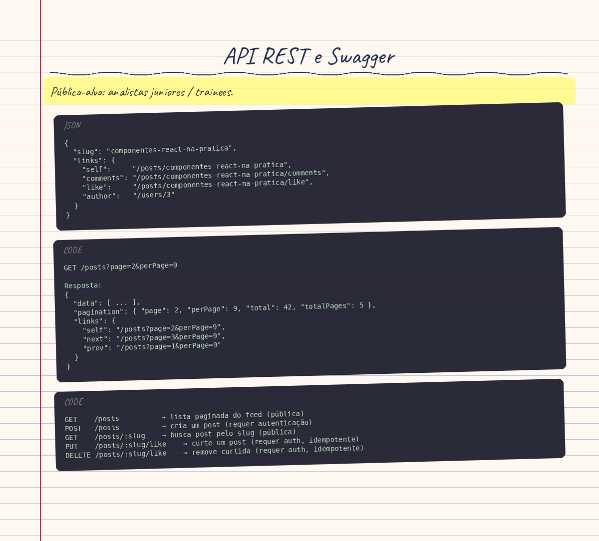

# API REST e Swagger

> **Público-alvo:** analistas juniores / trainees.

## Conceito Teórico

### O que é REST?

REST (Representational State Transfer) é um estilo arquitetural para APIs web. A ideia central é simples: a API expõe **recursos** (substantivos), não ações (verbos). Um recurso é qualquer "coisa" do domínio que o cliente pode criar, ler, alterar ou excluir.

Analogia: pense em um arquivo em um servidor FTP. O arquivo existe em um caminho (`/posts/meu-post`). O que você *faz* com ele (baixar, substituir, deletar) é determinado pelo verbo do protocolo, não pelo nome do caminho.

### Métodos HTTP e sua semântica

| Método   | Semântica                                            | Idempotente? | Cria recurso? |
|----------|------------------------------------------------------|:---:|:---:|
| `GET`    | Lê sem alterar estado                                | ✅  | ❌  |
| `POST`   | Cria um recurso novo                                 | ❌  | ✅  |
| `PUT`    | Substitui (ou cria) um recurso identificado pelo cliente | ✅  | ✅  |
| `DELETE` | Remove o recurso                                     | ✅  | ❌  |

**Idempotente** significa "fazer a mesma operação N vezes tem o mesmo efeito que fazer uma vez". Um duplo clique em "curtir" não deve criar duas curtidas — por isso o Code Connect usa `PUT /posts/:slug/like` em vez de `POST /posts/:slug/likes`.

### Códigos de status HTTP

Os códigos dizem ao cliente *o que aconteceu*, sem precisar ler o corpo da resposta:

| Faixa | Significado        | Exemplos usados na API                                           |
|-------|--------------------|------------------------------------------------------------------|
| 2xx   | Sucesso            | `200 OK`, `201 Created`, `204 No Content`                       |
| 4xx   | Erro do cliente    | `400 Bad Request`, `401 Unauthorized`, `404 Not Found`, `409 Conflict`, `429 Too Many Requests` |
| 5xx   | Erro do servidor   | `500 Internal Server Error`                                      |

### HATEOAS — links dentro da resposta

HATEOAS (Hypermedia as the Engine of Application State) é a prática de incluir, em cada resposta, os links para as operações relacionadas. O cliente não precisa "saber de cor" as URLs; ele as descobre na resposta.

Exemplo real: ao buscar um post, o cliente recebe:

```json
{
  "slug": "componentes-react-na-pratica",
  "links": {
    "self":     "/posts/componentes-react-na-pratica",
    "comments": "/posts/componentes-react-na-pratica/comments",
    "like":     "/posts/componentes-react-na-pratica/like",
    "author":   "/users/3"
  }
}
```

O front-end React usa `links.like` para saber para onde enviar o `PUT` de curtida — sem hardcodar o padrão de URL em dois lugares.

### Paginação offset-based

Retornar todos os posts de uma vez consome muita memória e banda. A paginação divide o resultado em páginas.

A estratégia **offset-based** é a mais simples:
- O cliente envia `page` (número da página) e `perPage` (itens por página).
- O banco pula `(page - 1) * perPage` linhas (`OFFSET`) e lê `perPage` linhas (`LIMIT`).
- A resposta inclui metadados (`total`, `totalPages`) e links de navegação (`next`, `prev`).

```
GET /posts?page=2&perPage=9

Resposta:
{
  "data": [ ... ],
  "pagination": { "page": 2, "perPage": 9, "total": 42, "totalPages": 5 },
  "links": {
    "self": "/posts?page=2&perPage=9",
    "next": "/posts?page=3&perPage=9",
    "prev": "/posts?page=1&perPage=9"
  }
}
```

### Slugs — identificadores legíveis por humanos

Um **slug** é uma versão URL-amigável de um título: letras minúsculas, sem acentos, espaços substituídos por hífens. Ex.: "Componentes React na prática" → `componentes-react-na-pratica`.

Por que usar slug em vez do `id` numérico?
- A URL `/posts/componentes-react-na-pratica` é descritiva e indexável por buscadores (SEO).
- Permite mover posts entre bancos sem invalidar links existentes.
- O título já é a identidade humana do post; o slug é só a versão URL-safe dele.

### DTOs vs Entities

| Conceito  | Papel                                     | Exemplo no projeto    |
|-----------|-------------------------------------------|-----------------------|
| **DTO** (Data Transfer Object) | Valida e descreve *entrada* do cliente (corpo da requisição) | `CreatePostDto` |
| **Entity** | Descreve a *saída* que o servidor devolve | `PostEntity`, `PostSummaryEntity` |

O banco de dados tem uma representação própria (`StoredPost`) que nunca vai para o cliente — ela pode conter campos internos como senhas ou IDs internos.

### Swagger / OpenAPI

**OpenAPI** é uma especificação para descrever APIs REST em JSON/YAML. O **Swagger UI** é uma interface gráfica que lê esse JSON e gera uma página interativa onde qualquer pessoa pode testar os endpoints sem Postman.

O NestJS gera o documento OpenAPI automaticamente a partir de decorators TypeScript — sem precisar manter um arquivo YAML manualmente.

### ValidationPipe e prevenção de mass assignment

**Mass assignment** é um ataque onde o cliente envia campos extras que o servidor não esperava — como `{ "title": "X", "authorId": 999 }` — e o servidor os aceita sem querer.

A combinação `whitelist: true` + `forbidNonWhitelisted: true` no `ValidationPipe` fecha essa brecha:
- `whitelist: true`: remove silenciosamente propriedades não declaradas no DTO.
- `forbidNonWhitelisted: true`: rejeita a requisição com `400` se houver qualquer propriedade extra.

---

## Aplicação no Code Connect

### Rotas do recurso `posts`

O `PostsController` expõe cinco rotas para o recurso `/posts`, todas seguindo a semântica REST:

```
GET    /posts          → lista paginada do feed (pública)
POST   /posts          → cria um post (requer autenticação)
GET    /posts/:slug    → busca post pelo slug (pública)
PUT    /posts/:slug/like    → curte um post (requer auth, idempotente)
DELETE /posts/:slug/like    → remove curtida (requer auth, idempotente)
```

**Decisão de design — `like` como sub-recurso singleton:**
A curtida é um recurso que pertence ao par *(post, usuário)*. Usar `PUT`/`DELETE` em vez de `POST`/`DELETE` em `/likes` torna as duas operações idempotentes: um duplo clique retorna `204` em vez de `409 Conflict` ou de criar duas curtidas.

### Header `Location` no POST

Após criar um post, o controller define o header `Location` com a URL do recurso criado:

```typescript
// posts.controller.ts:82
res.location(post.links.self);
```

Esse comportamento é padronizado pelo HTTP: uma resposta `201 Created` deve incluir `Location` apontando para o novo recurso, poupando ao cliente uma requisição extra para descobrir a URL.

### HATEOAS na prática — PostSummaryEntity

A classe `PostSummaryEntity` monta os links HATEOAS no construtor, usando o `slug` e o `author.id`:

```typescript
// post.entity.ts:110-115
this.links = {
  self:     `/posts/${post.slug}`,
  comments: `/posts/${post.slug}/comments`,
  like:     `/posts/${post.slug}/like`,
  author:   `/users/${post.author.id}`,
};
```

O front-end nunca precisa construir essas URLs manualmente — ele lê `post.links.like` e já sabe para onde enviar o `PUT`.

### `PostSummaryEntity` vs `PostEntity`

O feed (`GET /posts`) não devolve o campo `content` (corpo completo do post). Motivo:

> Carregar o conteúdo completo de 9 posts em cada renderização do feed desperdiçaria banda e aumentaria o tempo do primeiro paint.

Quando o usuário abre um post específico (`GET /posts/:slug`), a API devolve `PostEntity`, que estende `PostSummaryEntity` adicionando apenas o campo `content`.

```typescript
// post.entity.ts:120-127
export class PostEntity extends PostSummaryEntity {
  @ApiProperty({ example: 'Parágrafos separados por uma linha em branco.' })
  content: string;

  constructor(post: PostDetailRecord) {
    super(post);
    this.content = post.content;
  }
}
```

### Geração de slugs — `slug.ts`

O arquivo `slug.ts` tem duas responsabilidades:

**1. `slugify(title)`** — transforma qualquer título em slug URL-safe:
```
"Componentes React na prática" → "componentes-react-na-pratica"
"!!!" → "post"   (fallback para título inutilizável)
```

O algoritmo usa decomposição Unicode (NFD) para separar a letra base do acento, depois descarta os acentos — garantindo que "prática" vire "pratica" e não perca a letra "a".

**2. `uniqueSlug(title, taken)`** — garante unicidade:
```typescript
// slug.ts:30-45
export async function uniqueSlug(title, taken) {
  const base = slugify(title);
  const candidate = RESERVED_SLUGS.has(base) ? `${base}-post` : base;

  if (!(await taken(candidate))) return candidate;

  for (let suffix = 2; ; suffix++) {
    // Tenta "meu-post-2", "meu-post-3", ...
  }
}
```

Se `componentes-react-na-pratica` já existe, gera `componentes-react-na-pratica-2`, depois `-3`, e assim por diante.

**Slugs reservados:**
```typescript
// slug.ts:6
export const RESERVED_SLUGS = new Set(['novo', 'new']);
```

A rota de criação do post no front-end é `/posts/novo`. Sem essa proteção, publicar um post com título "Novo" tornaria essa página de criação inacessível.

### Paginação — `pagination.ts`

`buildPagination` calcula os metadados de paginação:

```typescript
// pagination.ts:4-11
export function buildPagination({ page, perPage, total }) {
  // Math.max(1, ...) garante que uma coleção vazia ainda retorne totalPages=1
  const totalPages = Math.max(1, Math.ceil(total / perPage));
  return { page, perPage, total, totalPages };
}
```

`buildCollectionLinks` gera os links `self`/`next`/`prev` usando `URLSearchParams`, preservando filtros como `?q=react`:

```typescript
// pagination.ts:16-36
export function buildCollectionLinks(basePath, params, page, totalPages) {
  const href = (target) => {
    const search = new URLSearchParams();
    // Preserva ?q=react, ?perPage=9, etc.
    for (const [key, value] of Object.entries(params)) {
      if (value !== undefined && value !== '') search.set(key, String(value));
    }
    search.set('page', String(target));
    return `${basePath}?${search.toString()}`;
  };
  return {
    self: href(page),
    next: page < totalPages ? href(page + 1) : null,
    prev: page > 1        ? href(page - 1) : null,
  };
}
```

### DTOs de entrada — `CreatePostDto`

O `CreatePostDto` usa decorators do `class-validator` para validar cada campo na entrada:

```typescript
// create-post.dto.ts:6-54
export class CreatePostDto {
  @Transform(trim)
  @IsString()
  @MinLength(3)
  @MaxLength(120)
  title: string;

  @Transform(trim)
  @IsString()
  @MinLength(50)
  @MaxLength(160)
  excerpt: string;

  @Transform(trim)
  @IsString()
  @MinLength(20)
  @MaxLength(10_000)
  content: string;

  @IsOptional()
  @MaxLength(500)
  @Matches(/^(https?:\/\/|\/)/, { message: '...' })
  thumbnailUrl?: string;
}
```

**Decisão de design — `@Matches` em vez de `@IsUrl`:**
O decorator `@IsUrl` do `class-validator` rejeita caminhos relativos como `/posts/foto.webp` — que é exatamente o formato dos thumbnails do seed. O regex `^(https?:\/\/|\/)` valida tanto URLs absolutas quanto caminhos relativos à raiz.

### ValidationPipe — proteção de mass assignment

Em `app.setup.ts`, o pipe é registrado globalmente com as duas opções de segurança:

```typescript
// app.setup.ts:19-23
new ValidationPipe({
  whitelist: true,           // descarta campos não declarados no DTO
  forbidNonWhitelisted: true, // retorna 400 se houver campo extra
  transform: true,           // converte strings para os tipos TypeScript declarados
})
```

**Exemplo de ataque bloqueado:**
```json
// Requisição maliciosa
POST /posts
{ "title": "X", "excerpt": "...", "content": "...", "authorId": 999 }

// Resposta da API
400 Bad Request
{ "message": ["property authorId should not exist"] }
```

### Configuração do Swagger — `swagger.ts`

O Swagger é configurado no `swagger.ts` com o `DocumentBuilder`:

```typescript
// swagger.ts:5-24
export function setupSwagger(app) {
  const config = new DocumentBuilder()
    .setTitle('Code Connect API')
    .setDescription('...')
    .setVersion('1.0')
    .addCookieAuth(ACCESS_TOKEN_COOKIE, ...)  // autenticação por cookie
    .addApiKey({ in: 'header', name: CSRF_HEADER }, 'csrf')  // CSRF
    .build();

  const document = SwaggerModule.createDocument(app, config);
  SwaggerModule.setup('api/docs', app, document);  // UI em /api/docs
  //                                               // JSON em /api/docs-json
}
```

**Por que sem o CLI plugin (`@nestjs/swagger/plugin`)?**
O plugin do Swagger CLI lê os arquivos TypeScript em tempo de build para inferir metadados automaticamente. O projeto não o usa porque ele exige uma integração no `nest-cli.json` que complicaria o build e tornaria o comportamento da documentação menos explícito. Preferiu-se declarar tudo explicitamente com `@ApiProperty`.

### Decorators de resposta no Controller

Cada endpoint documenta suas respostas possíveis com decorators do `@nestjs/swagger`:

```typescript
// posts.controller.ts:65-75
@Throttle({ default: CREATE_POST_THROTTLE })
@Post()
@ApiBearerAuth()
@ApiOperation({ summary: 'Publica um post' })
@ApiCreatedResponse({ type: PostEntity })
@ApiBadRequestResponse({ type: ErrorResponseDto })
@ApiUnauthorizedResponse({ type: ErrorResponseDto })
@ApiConflictResponse({ type: ErrorResponseDto })
@ApiTooManyRequestsResponse({ type: ErrorResponseDto, description: 'Veja o header Retry-After' })
async create(...) { ... }
```

Cada `@ApiXxxResponse({ type: SomeClass })` faz o Swagger gerar automaticamente o schema JSON da classe — desde que todos os campos estejam anotados com `@ApiProperty`.

---

## Erros Comuns e Armadilhas

### 1. Retornar 200 em vez de 201 ao criar um recurso

**Erro:** usar `@Get()` + `return` sem `@HttpCode(HttpStatus.CREATED)` em um endpoint de criação.

**Consequência:** o cliente não consegue distinguir "leitura bem-sucedida" de "recurso criado". Ferramentas de integração e caches HTTP podem se comportar incorretamente.

**Correto:** `@Post()` já retorna `201` por padrão no NestJS. Não use `@HttpCode(HttpStatus.OK)` em endpoints de criação.

---

### 2. Omitir `@ApiProperty` em campos da Entity

**Erro:** adicionar um campo à classe sem decorar com `@ApiProperty`.

**Consequência:** o campo aparece no JSON de resposta em tempo de execução, mas **não aparece no schema do Swagger**. Quem lê a documentação não sabe que o campo existe.

**Correto:** todo campo público de uma Entity ou DTO que é serializado na resposta precisa de `@ApiProperty` (ou `@ApiPropertyOptional` para opcionais).

---

### 3. Não usar `@Transform(trim)` nos campos de string do DTO

**Erro:** receber `"  meu título  "` (com espaços) e salvar no banco sem tratar.

**Consequência:** dois posts com o mesmo título mas espaçamentos diferentes gerariam slugs idênticos; o banco levantaria uma violação de unicidade inesperada.

**Correto:** o `@Transform(trim)` do `class-transformer` garante que o valor chegue ao service já sem espaços nas pontas.

---

### 4. Confundir `whitelist` com `forbidNonWhitelisted`

**Erro:** usar apenas `whitelist: true` acreditando que campos extras causam erro.

**Comportamento real com só `whitelist: true`:** campos extras são **silenciosamente removidos** — o request passa, mas sem os campos invasores.

**Com `forbidNonWhitelisted: true`:** o request é **rejeitado com 400** se houver qualquer campo não declarado.

A combinação dos dois é mais segura porque torna o ataque visível (retorna erro) ao invés de silenciá-lo.

---

### 5. Usar `POST` para operações idempotentes

**Erro:** implementar curtida como `POST /posts/:slug/likes`.

**Problema:** `POST` não é idempotente. Um duplo clique criaria duas curtidas (ou um `409 Conflict` se o banco tiver constraint). O front-end precisaria de lógica extra para evitar chamadas duplicadas.

**Correto:** usar `PUT /posts/:slug/like` (idempotente por definição). O `PostsService` usa `createMany({ skipDuplicates: true })` para garantir que a idempotência valha mesmo no banco.

---

### 6. Esquecer slugs reservados

**Erro:** não definir `RESERVED_SLUGS`.

**Consequência:** um post com título "Novo" criaria o slug `novo`, que conflita com a rota `/posts/novo` do front-end (página de criação de post). A rota de criação ficaria inacessível para usuários com esse post no feed.

---

### 7. Serializar `BigInt` do PostgreSQL diretamente em JSON

**Erro:** retornar o resultado de `count(*) OVER ()` do Prisma diretamente sem converter.

**Consequência:** `JSON.stringify` lança `TypeError: Do not know how to serialize a BigInt`. O endpoint de busca retornaria `500` para qualquer pesquisa.

**Correto:** converter explicitamente com `Number(firstRanked.total)` antes de usar o valor (veja `posts.service.ts:119`).

---

## Rastreabilidade

| Conceito | Arquivo | Linha/Trecho |
|----------|---------|--------------|
| Rotas REST do recurso posts | [apps/api/src/posts/posts.controller.ts](../../apps/api/src/posts/posts.controller.ts) | L42–L129 |
| Header `Location` após criação | [apps/api/src/posts/posts.controller.ts](../../apps/api/src/posts/posts.controller.ts) | L82 |
| Idempotência do like com `PUT`/`DELETE` | [apps/api/src/posts/posts.controller.ts](../../apps/api/src/posts/posts.controller.ts) | L99–L128 |
| `createMany({ skipDuplicates })` | [apps/api/src/posts/posts.service.ts](../../apps/api/src/posts/posts.service.ts) | L184–L187 |
| Links HATEOAS na Entity | [apps/api/src/posts/entities/post.entity.ts](../../apps/api/src/posts/entities/post.entity.ts) | L40–L52, L110–L115 |
| `PostSummaryEntity` vs `PostEntity` | [apps/api/src/posts/entities/post.entity.ts](../../apps/api/src/posts/entities/post.entity.ts) | L56–L128 |
| `slugify` — normalização Unicode | [apps/api/src/posts/slug.ts](../../apps/api/src/posts/slug.ts) | L10–L26 |
| `uniqueSlug` — unicidade com sufixo | [apps/api/src/posts/slug.ts](../../apps/api/src/posts/slug.ts) | L30–L45 |
| `RESERVED_SLUGS` | [apps/api/src/posts/slug.ts](../../apps/api/src/posts/slug.ts) | L6 |
| `buildPagination` — metadados | [apps/api/src/common/pagination.ts](../../apps/api/src/common/pagination.ts) | L3–L11 |
| `buildCollectionLinks` — next/prev | [apps/api/src/common/pagination.ts](../../apps/api/src/common/pagination.ts) | L16–L36 |
| `PaginationDto` e `CollectionLinksDto` | [apps/api/src/common/dto/paginated.dto.ts](../../apps/api/src/common/dto/paginated.dto.ts) | L1–L37 |
| `CreatePostDto` — validação de entrada | [apps/api/src/posts/dto/create-post.dto.ts](../../apps/api/src/posts/dto/create-post.dto.ts) | L6–L55 |
| `@Matches` vs `@IsUrl` para thumbnailUrl | [apps/api/src/posts/dto/create-post.dto.ts](../../apps/api/src/posts/dto/create-post.dto.ts) | L39–L54 |
| `ValidationPipe` com whitelist e forbidNonWhitelisted | [apps/api/src/app.setup.ts](../../apps/api/src/app.setup.ts) | L19–L23 |
| `setupSwagger` — DocumentBuilder e segurança | [apps/api/src/swagger.ts](../../apps/api/src/swagger.ts) | L5–L24 |
| Conversão de `BigInt` para evitar erro no JSON | [apps/api/src/posts/posts.service.ts](../../apps/api/src/posts/posts.service.ts) | L119 |

---

_Última atualização: 2026-10-09 | Gerado a partir do código-fonte._

<!-- infographic-start -->

<!-- infographic-end -->
