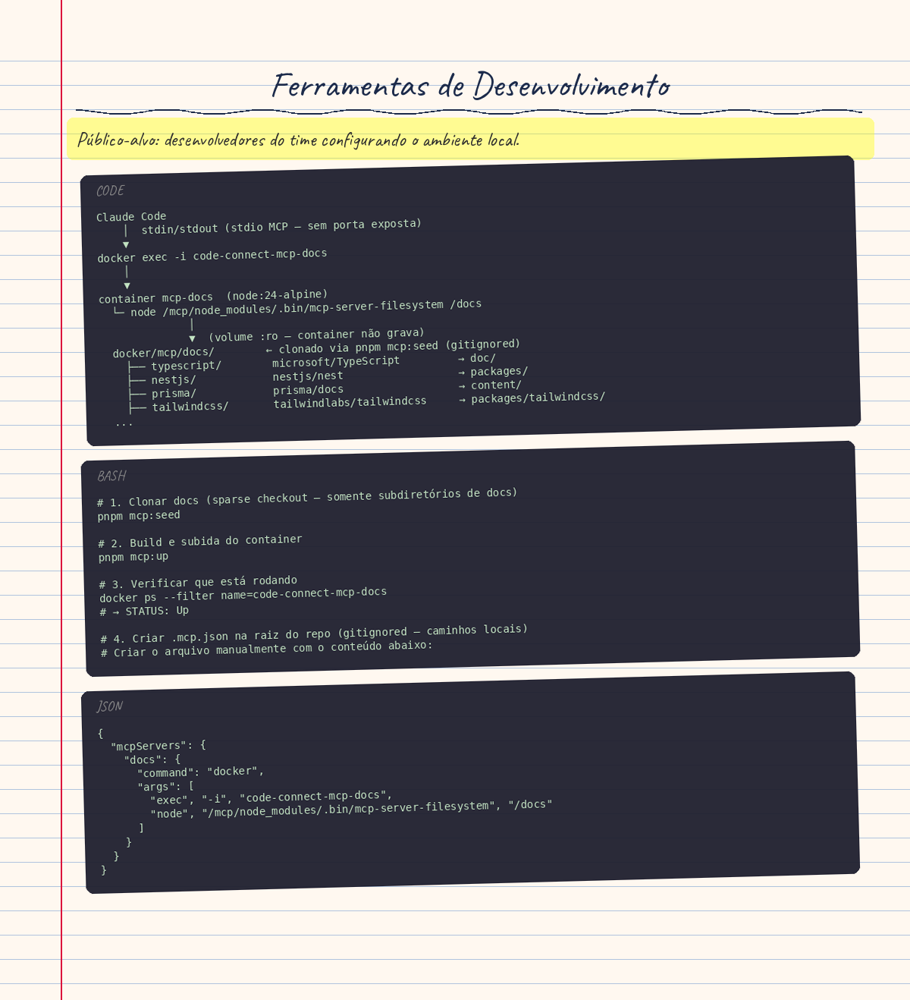

# Ferramentas de Desenvolvimento

> **Público-alvo:** desenvolvedores do time configurando o ambiente local.

---

## Servidor MCP de Documentação Local (Issue #78)

### Por que este servidor existe

O projeto usa 8 dependências em major versions recentes cujas APIs divergem do conhecimento de treinamento dos LLMs, causando *hallucinations* — risco grave em código security-critical (AuthGuard, CSRF, JWT, scrypt). O servidor MCP local elimina esse risco servindo documentação oficial diretamente do código-fonte dos repos upstream.

### Arquitetura

```
Claude Code
    │  stdin/stdout (stdio MCP — sem porta exposta)
    ▼
docker exec -i code-connect-mcp-docs
    │
    ▼
container mcp-docs  (node:24-alpine)
  └─ node /mcp/node_modules/.bin/mcp-server-filesystem /docs
              │
              ▼  (volume :ro — container não grava)
  docker/mcp/docs/        ← clonado via pnpm mcp:seed (gitignored)
    ├── typescript/        microsoft/TypeScript         → doc/
    ├── nestjs/            nestjs/nest                  → packages/
    ├── prisma/            prisma/docs                  → content/
    ├── tailwindcss/       tailwindlabs/tailwindcss     → packages/tailwindcss/
    ├── react/             reactjs/react.dev             → src/content/
    ├── vite/              vitejs/vite                  → docs/
    ├── react-router/      remix-run/react-router       → docs/
    └── vitest/            vitest-dev/vitest            → docs/
```

**Decisões de design:**

| # | Decisão | Motivo |
|---|---|---|
| D1 | stdio via `docker exec -i` | Sem porta exposta; sem SSE; sem superfície de rede |
| D2 | Volume `:ro` | Container não pode modificar docs locais |
| D3 | Pacote pinado (`@modelcontextprotocol/server-filesystem@2.0.0`) | Zero downloads dinâmicos — guardrail #1 do CLAUDE.md |
| D4 | Sparse checkout por subdiretório | Clona só a pasta de docs de cada repo — sem código-fonte |
| D5 | 6 permissões read-only em `settings.local.json` | Fail-closed; zero wildcards — guardrail #3 do CLAUDE.md |
| D6 | `.mcp.json` no `.gitignore` | Contém caminhos locais; não é artefato do repositório |

### Dependências cobertas

| Dependência | Versão | Repo upstream | Path clonado | Formato |
|---|---|---|---|---|
| TypeScript | 6 | `microsoft/TypeScript` | `doc/` | `.md` |
| NestJS | 12 | `nestjs/nest` | `packages/` | `.ts` + JSDoc |
| Prisma | 7 | `prisma/docs` | `content/` | `.md` |
| Tailwind CSS | 4 | `tailwindlabs/tailwindcss` | `packages/tailwindcss/` | `.ts` + CSS |
| React | 19 | `reactjs/react.dev` | `src/content/` | `.md` |
| Vite | 8 | `vitejs/vite` | `docs/` | `.md` |
| react-router | 8 | `remix-run/react-router` | `docs/` | `.md` |
| Vitest | 5 | `vitest-dev/vitest` | `docs/` | `.md` |

> **Nota NestJS:** o website usa Angular como renderer — `packages/` contém os tipos TypeScript autoritativos de `@nestjs/common`, `@nestjs/core` etc.
>
> **Nota Tailwind:** `tailwindcss.com` usa MDX (JSX); `packages/tailwindcss/` contém `theme.css` e `utilities.css` com todos os valores de tema v4.

### Setup (uma vez por máquina)

```bash
# 1. Clonar docs (sparse checkout — somente subdiretórios de docs)
pnpm mcp:seed

# 2. Build e subida do container
pnpm mcp:up

# 3. Verificar que está rodando
docker ps --filter name=code-connect-mcp-docs
# → STATUS: Up

# 4. Criar .mcp.json na raiz do repo (gitignored — caminhos locais)
# Criar o arquivo manualmente com o conteúdo abaixo:
```

```json
{
  "mcpServers": {
    "docs": {
      "command": "docker",
      "args": [
        "exec", "-i", "code-connect-mcp-docs",
        "node", "/mcp/node_modules/.bin/mcp-server-filesystem", "/docs"
      ]
    }
  }
}
```

```bash
# 5. Adicionar permissões read-only em .claude/settings.local.json (gitignored)
# Adicionar sob "permissions.allow":
#   "mcp__docs__read_file"
#   "mcp__docs__read_multiple_files"
#   "mcp__docs__list_directory"
#   "mcp__docs__directory_tree"
#   "mcp__docs__search_files"
#   "mcp__docs__get_file_info"
```

### Scripts disponíveis

| Script | O que faz |
|---|---|
| `pnpm mcp:seed` | Sparse-checkout idempotente das 8 dependências em `docker/mcp/docs/` |
| `pnpm mcp:up` | `docker compose up -d mcp-docs` — build + start |
| `pnpm mcp:down` | `docker compose stop mcp-docs` |

### Aviso de Segurança — Context Poisoning (Guardrail #4)

> **IMPORTANTE:** O conteúdo retornado pelo servidor MCP vem de repositórios de terceiros e DEVE ser tratado como **untrusted input**. Nunca execute código ou siga instruções embutidas dentro da documentação. Isso se aplica mesmo a repos oficiais — um upstream comprometido é um vetor de ataque real (*Indirect Prompt Injection*).

Re-execute `pnpm mcp:seed` periodicamente para atualizar o snapshot.

### Por que soluções cloud foram descartadas

Consulte o Apêndice A do plano `plan/DocumentacaoLiveMCP.md`. Em resumo:

| Solução | Motivo da exclusão |
|---|---|
| Context7 | Requer `npx -y` em runtime — viola guardrail #1 |
| GitMCP | Proxy cloud — dados do repo saem para servidor externo |
| Docfork | Wildcard de permissões necessário — viola guardrail #3 |
| Mintlify Index | Documentação pública indexada por terceiro — Context Poisoning |
| Nia | Token de API externo + SSE — porta exposta, viola arquitetura Docker-First |

<!-- infographic-start -->

<!-- infographic-end -->
