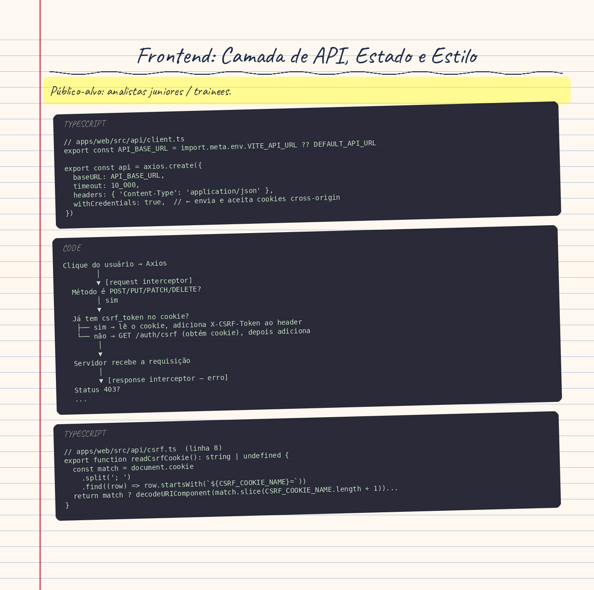

# Frontend: Camada de API, Estado e Estilo

> **Público-alvo:** analistas juniores / trainees.

---

## Conceito Teórico

Aplicações React modernas precisam resolver três problemas ao mesmo tempo: **como falar com o servidor**, **como organizar o estado resultante** e **como traduzir esse estado em pixels**. Este artigo percorre cada uma dessas camadas no Code Connect, explicando o porquê de cada decisão antes de mostrar o código.

### Comunicação HTTP com o servidor

Toda requisição HTTP carrega contexto implícito: quem está fazendo a chamada, se ela pode modificar dados, se deve repetir automaticamente diante de certos erros. Uma camada de API centralizada (em vez de `fetch` espalhado em componentes) isola essas regras em um único lugar.

O **Axios** é uma biblioteca HTTP que embrulha o `fetch` do navegador com três superpoderes úteis: transformação automática de JSON, `interceptors` (ganchos que rodam antes/depois de cada requisição) e tipagem TypeScript nativa.

### Segurança: cookies, CORS e CSRF

Há um triângulo de conceitos que todo desenvolvedor frontend precisa entender:

- **Cookie `httpOnly`**: definido pelo servidor, invisível ao JavaScript. É onde a sessão do usuário vive — se o JS não pode ler, não pode vazar por XSS.
- **CORS (Cross-Origin Resource Sharing)**: política do navegador que bloqueia requisições cross-origin por padrão. Para enviar cookies junto com a requisição, o Axios precisa de `withCredentials: true` e o servidor precisa responder com `Access-Control-Allow-Credentials: true`.
- **CSRF (Cross-Site Request Forgery)**: ataque em que um site malicioso faz o navegador da vítima disparar uma requisição autenticada para outro domínio, aproveitando o cookie de sessão. A defesa é um token secundário que **só o JavaScript legítimo consegue ler**: o `csrf_token` (cookie comum, não-httpOnly) que o cliente copia para o cabeçalho `X-CSRF-Token`.

### Estado sem biblioteca de gerenciamento

"Você precisa de Redux?" é uma das perguntas mais frequentes no ecossistema React. A resposta depende do problema. Redux, Zustand e Context resolvem o problema de **estado global compartilhado entre partes distantes da árvore**. Quando o estado é essencialmente **dados da API, local a uma única página** e precisa ser passado para poucos filhos diretos, essas ferramentas introduzem complexidade sem benefício equivalente.

O padrão alternativo é: **hook customizado na página → props para componentes filhos**. As páginas buscam os dados, os componentes os exibem.

### UI Otimista

Imagine clicar num botão "curtir" e esperar a resposta da API antes do coração mudar de cor. A experiência parece lenta mesmo em conexões rápidas. "UI otimista" é a técnica de aplicar a mudança visualmente no momento do clique e **desfazê-la (rollback) somente se a API falhar**. Como likes e unlikes são operações idempotentes (clicar duas vezes é equivalente a clicar uma), o rollback é matematicamente seguro.

### Tailwind CSS v4 — configuração CSS-first

Versões anteriores do Tailwind precisavam de um arquivo `tailwind.config.js` em JavaScript para definir a paleta de cores, fontes e escala tipográfica. A v4 mudou a abordagem: toda a configuração vai **dentro do próprio CSS**, em um bloco `@theme`. O resultado é um arquivo de design system declarativo, sem precisar sair do CSS.

---

## Aplicação no Code Connect

### Cliente Axios (`apps/web/src/api/client.ts`)

A instância central do Axios é criada com três configurações essenciais:

```typescript
// apps/web/src/api/client.ts
export const API_BASE_URL = import.meta.env.VITE_API_URL ?? DEFAULT_API_URL

export const api = axios.create({
  baseURL: API_BASE_URL,
  timeout: 10_000,
  headers: { 'Content-Type': 'application/json' },
  withCredentials: true,  // ← envia e aceita cookies cross-origin
})
```

**Por que `withCredentials: true`?**
A sessão viaja num cookie `httpOnly` (invisível ao JS). Sem essa flag, o navegador não envia esse cookie para um domínio diferente do da página. Em desenvolvimento, a web roda em `localhost:5173` e a API em `localhost:3000` — são origens distintas para o navegador.

**Por que `VITE_API_URL` e não uma constante hardcoded?**
Em CI/CD, o endereço da API muda por ambiente (desenvolvimento, staging, produção). Variáveis de ambiente injetadas no build permitem o mesmo binário ser configurado externamente.

**Atenção crítica — variáveis `VITE_*` são públicas:**
O Vite substitui `import.meta.env.VITE_*` por valores literais em tempo de build. Isso significa que **qualquer variável com prefixo `VITE_` acaba legível no bundle JavaScript** que vai para o navegador. Nunca coloque chaves de API privadas, segredos ou senhas em variáveis `VITE_*`.

### Ciclo do Interceptor CSRF (`apps/web/src/api/csrf.ts` + `client.ts`)

O projeto implementa proteção CSRF com um ciclo de dois interceptors:

```
Clique do usuário → Axios
        │
        ▼ [request interceptor]
  Método é POST/PUT/PATCH/DELETE?
        │ sim
        ▼
  Já tem csrf_token no cookie?
   ├── sim → lê o cookie, adiciona X-CSRF-Token ao header
   └── não → GET /auth/csrf (obtém cookie), depois adiciona
        │
        ▼
  Servidor recebe a requisição
        │
        ▼ [response interceptor — erro]
  Status 403?
   ├── já tentamos uma vez (_csrfRetried = true)? → rejeita definitivamente
   └── primeira vez → resetCsrfToken() + ensureCsrfToken() + repete a requisição
```

**Leitura do cookie no frontend:**
```typescript
// apps/web/src/api/csrf.ts  (linha 8)
export function readCsrfCookie(): string | undefined {
  const match = document.cookie
    .split('; ')
    .find((row) => row.startsWith(`${CSRF_COOKIE_NAME}=`))
  return match ? decodeURIComponent(match.slice(CSRF_COOKIE_NAME.length + 1)) : undefined
}
```
O `csrf_token` é deliberadamente **não-httpOnly** (diferente do cookie de sessão) para que o JavaScript consiga lê-lo. Se fosse `httpOnly`, o JS não poderia copiar o valor para o cabeçalho — e o CSRF não funcionaria.

**Memoização do bootstrap:**
```typescript
// apps/web/src/api/csrf.ts  (linha 22–37)
let bootstrap: Promise<string | undefined> | null = null

export function ensureCsrfToken(): Promise<string | undefined> {
  const existing = readCsrfCookie()
  if (existing) return Promise.resolve(existing)

  bootstrap ??= api.get('/auth/csrf')
    .then(() => readCsrfCookie())
    .finally(() => { bootstrap = null })
  return bootstrap
}
```
Sem essa memoização, dois formulários submetidos simultaneamente disparariam dois `GET /auth/csrf` desnecessários. O operador `??=` garante que a promise existente seja reutilizada enquanto ainda estiver em progresso.

### A Flag `_csrfRetried` — por que não um `WeakSet`

Esta é uma das decisões mais sutis do código. A primeira intuição seria rastrear as requisições já repetidas num `WeakSet`:

```typescript
// ❌ NÃO FUNCIONA — assim estava a ideia inicial
const retried = new WeakSet()

// no response interceptor:
if (error.response?.status === 403 && !retried.has(error.config)) {
  retried.add(error.config)
  // ...repete
}
```

O problema: o Axios chama `mergeConfig()` internamente ao repetir uma requisição, criando **um novo objeto de config**. O `WeakSet` verifica identidade de objeto (`===`), então o objeto novo nunca é reconhecido como "já tentado" — a requisição repetiria para sempre em loop.

A solução do projeto:

```typescript
// apps/web/src/api/client.ts  (linha 19)
type RetriableConfig = InternalAxiosRequestConfig & { _csrfRetried?: boolean }
```

Uma propriedade copiada **dentro do próprio objeto de config** sobrevive ao `mergeConfig()` porque o merge copia as propriedades. A flag viaja junto com os dados da requisição.

### Tradução de Erros (`apps/web/src/api/errors.ts`)

```typescript
// apps/web/src/api/errors.ts
export function getErrorMessage(error: unknown): string {
  if (!axios.isAxiosError(error) || !error.response) {
    return 'Não foi possível conectar ao servidor. Tente novamente.'
  }

  switch (error.response.status) {
    case 400: return 'Verifique os dados informados.'
    case 401: return 'Email ou senha inválidos.'
    case 404: return 'Conteúdo não encontrado.'
    case 409: return 'Este email já está cadastrado.'
    case 429: {
      const seconds = Number(error.response.headers['retry-after'])
      return seconds > 0
        ? `Muitas tentativas. Aguarde ${seconds} segundos e tente novamente.`
        : 'Muitas tentativas. Aguarde um minuto e tente novamente.'
    }
    default: return 'Algo deu errado. Tente novamente.'
  }
}
```

**Por que nunca exibir a mensagem da API?**
A API retorna mensagens em inglês, técnicas, voltadas para desenvolvedores (`"Unauthorized"`, `"Validation failed: email must be an email"`). Exibir isso para um usuário final é má experiência. Pior: pode expor detalhes de implementação interna que auxiliam um atacante.

**Por que traduzir no frontend e não na API?**
A API pode ter múltiplos clientes (web, mobile, integrações). Localização (i18n) é responsabilidade do cliente. O frontend sabe o idioma do usuário; a API não precisa saber.

**O caso especial do 429:**
O cabeçalho `Retry-After` (segundos até poder tentar novamente) é lido diretamente da resposta para dar uma mensagem precisa ao usuário.

O arquivo ainda expõe helpers de checagem de status para uso nos hooks:

```typescript
export function isUnauthorized(error: unknown): boolean { /* 401 */ }
export function isNotFound(error: unknown): boolean     { /* 404 */ }
export function isConflict(error: unknown): boolean     { /* 409 */ }
```

### Funções de API por Recurso (`auth.ts`, `posts.ts`)

Cada módulo expõe funções simples, sem estado, que chamam o cliente Axios e retornam os dados tipados:

```typescript
// apps/web/src/api/posts.ts  (linha 11–19)
export async function listPosts(
  { q, page, perPage }: ListPostsParams = {},
  signal?: AbortSignal,
): Promise<PostCollection> {
  const { data } = await api.get<PostCollection>('/posts', {
    params: { ...(q ? { q } : {}), ...(page ? { page } : {}), ...(perPage ? { perPage } : {}) },
    signal,
  })
  return data
}
```

**O parâmetro `signal?: AbortSignal`** é o mecanismo de cancelamento. Quando o usuário navega para outra página antes da resposta chegar, o hook passa o sinal de um `AbortController` — o Axios cancela a requisição em voo e o hook ignora o resultado, evitando um `setState` numa árvore já desmontada.

**Por que filtrar parâmetros antes de enviar?**
```typescript
{ ...(q ? { q } : {}), ...(page ? { page } : {}) }
```
A API usa `ValidationPipe` com `forbidNonWhitelisted: true`. Parâmetros não declarados causam erro 400. Enviar `q=undefined` ou `page=0` como string `"undefined"/"0"` confundiria o validador — por isso os parâmetros são omitidos quando vazios.

**OIDC — login com provedor social:**
```typescript
// apps/web/src/api/auth.ts  (linha 31–33)
export function startOidcLogin(providerId: string): void {
  window.location.href = `${API_BASE_URL}/auth/oidc/${providerId}/start`
}
```
Esta função não usa Axios. O fluxo OIDC é uma série de redirecionamentos de página (browser → provedor → API → web) — não há resposta JSON para interceptar. Por isso a navegação é feita via `window.location.href`.

### Tipos da API (`apps/web/src/api/types.ts`)

Todos os contratos de dados entre frontend e API são declarados em um único arquivo de tipos:

```typescript
// Sessão viaja em cookie; o corpo só confirma metadados
export type LoginResponse = {
  tokenType: 'Bearer'
  expiresIn: number
}

// null significa "visitante anônimo", não "erro"
export type SessionResponse = {
  user: User | null
}

// Feed omite `content` — só o endpoint de post único o retorna
export type FeedPost = { slug: string; title: string; /* ... */ }
export type PostDetail = FeedPost & { content: string }
```

Esses tipos espelham o Swagger da API (`/api/docs`). Quando a API muda um campo, o TypeScript aponta imediatamente todos os lugares do frontend que precisam ser atualizados.

### Hooks Customizados — Estado por Página

Os hooks vivem em `apps/web/src/pages/` e nunca dentro de `components/`. Essa convenção garante que componentes sejam **ignorantes da camada de API** — eles recebem dados por props, o que os torna testáveis sem mock de HTTP.

#### `useSession` — Quem está logado?

```typescript
// apps/web/src/pages/useSession.ts  (linha 36–87)
export function useSession(): Session {
  const [status, setStatus] = useState<SessionStatus>('loading')
  const [user, setUser] = useState<User>()

  useEffect(() => {
    const controller = new AbortController()
    getSession(controller.signal) // GET /auth/session, não /auth/me
      .then(({ user: me }) => { /* ... */ })
      .catch(/* ... */)
    return () => controller.abort()
  }, [])
  // ...
}
```

**Por que `/auth/session` e não `/auth/me`?**
`/auth/me` responde 401 para visitantes anônimos. Um 401 aparece vermelho no console do navegador — isso quebra auditorias do Lighthouse e a suíte de testes de acessibilidade que verifica "sem erros no console". `/auth/session` responde 200 com `user: null` para visitantes anônimos, que é o caso normal em páginas públicas.

**Por que hook e não Context?**
O comentário no código documenta a decisão: os dois consumidores (`sidebar` e controles de like/comentário) estão sempre dentro da subárvore de uma única página — nunca montados ao mesmo tempo. Criar um Context seria overhead para um problema que não existe ainda. O comentário inclusive instrui: *"Se um header for hoistado fora de `<Routes>`, promover este para um context."*

#### `useFeed` — Lista de Posts com Like Otimista

```typescript
// apps/web/src/pages/useFeed.ts  (linha 39)
export function useFeed({ q, page, onUnauthorized }: UseFeedParams): Feed
```

O hook encapsula: busca paginada de posts, estado de carregamento/erro, e a lógica de like otimista. O estado é armazenado como `FeedResult` (resultado + chave da query):

```typescript
// apps/web/src/pages/useFeed.ts  (linha 27–31)
type FeedResult = {
  key: string         // `${q}|${page}` — identifica a query
  collection?: PostCollection
  error?: string
}
```

**Por que armazenar a `key` junto com o resultado?**
```typescript
// apps/web/src/pages/useFeed.ts  (linha 63)
const current = result?.key === key ? result : undefined
const loading = current === undefined
```
Se armazenássemos `loading` como estado separado (`setLoading(true)`), teríamos um flash de `loading=false` entre o clique na paginação e o `useEffect` disparar. Com a chave, `loading` é derivado: se o resultado armazenado não pertence à query atual, estamos carregando.

**UI Otimista no Like:**
```typescript
// apps/web/src/pages/useFeed.ts  (linha 73–99)
const liked = post.likedByMe
const apply = (value: boolean) => {
  setResult((previous) => /* atualiza likedByMe e likeCount no post local */)
}

apply(!liked)        // 1. aplica otimisticamente — a UI muda agora
setPendingSlug(slug)

const request = liked ? unlikePost(slug) : likePost(slug)
request.catch((likeError) => {
  apply(liked)       // 2. rollback — desfaz se a API falhar
  // ...
})
```

**Por que `useRef` para o guard de duplo clique?**
```typescript
// apps/web/src/pages/useFeed.ts  (linha 48)
const pendingRef = useRef(false)
```
Dois cliques rápidos chegam no mesmo ciclo de render. No momento do segundo clique, `pendingSlug` (estado) ainda não foi commitado pelo React — ambos os handlers leram `null`. O `useRef` é lido e escrito sincronamente, fora do ciclo de render, e bloqueia o segundo clique imediatamente.

#### `usePostDetail` — Post Completo com Comentários

```typescript
// apps/web/src/pages/usePostDetail.ts  (linha 42)
export function usePostDetail({ slug, onUnauthorized }: UsePostDetailParams): PostDetailState
```

O post e seus comentários são buscados em paralelo:

```typescript
// apps/web/src/pages/usePostDetail.ts  (linha 58–80)
useEffect(() => {
  const controller = new AbortController()
  getPost(slug, controller.signal)      // primeiro paint espera por este
    .then(...)
    .catch(...)

  listComments(slug, undefined, controller.signal)  // carrega por conta própria
    .then(...)
    .catch(() => {
      // Um post sem comentários ainda é útil. Não bloqueia a renderização.
      if (controller.signal.aborted) return
      setCommentsResult({ slug, comments: [] })
    })

  return () => controller.abort()
}, [slug])
```

O `submitComment` demonstra um padrão interessante: após criar um comentário, o hook **não refaz o GET de comentários**. Em vez disso, acrescenta o comentário recém-criado ao array local e incrementa `commentCount` no post. Isso economiza uma requisição e é correto porque o servidor retorna o comentário criado completo.

#### `usePageMeta` — Título e Descrição da Página

```typescript
// apps/web/src/pages/usePageMeta.ts
export function usePageMeta(page: string, description: string) {
  useEffect(() => {
    document.title = `${page} | ${SITE_NAME}`
    let meta = document.querySelector<HTMLMetaElement>('meta[name="description"]')
    if (!meta) {
      meta = document.createElement('meta')
      meta.name = 'description'
      document.head.append(meta)
    }
    meta.content = description
  }, [page, description])
}
```

**Por que um hook e não um componente `<Helmet>`?**
Bibliotecas como `react-helmet` existem para isso, mas adicionam dependência externa para uma tarefa que o DOM API resolve em 10 linhas. O hook cria a tag `<meta>` se não existir (o `index.html` já tem uma padrão), ou atualiza seu `content`.

**Por que isso importa para SEO e acessibilidade?**
WCAG 2.4.2 exige que cada página tenha título descritivo. Motores de busca usam `<meta name="description">` como snippet nos resultados. Sem isso, o Lighthouse perde pontos em "SEO" e "Best Practices".

### Tailwind CSS v4 — Sistema de Tokens (`apps/web/src/index.css`)

```css
/* apps/web/src/index.css */
@import "tailwindcss";

@theme {
  --color-page:    #00090e;   /* fundo da página */
  --color-surface: #171d1f;   /* cards, modais */
  --color-primary: #81fe88;   /* ações principais */
  --color-input:   #888888;   /* placeholders */
  --color-offwhite: #e1e1e1;  /* texto principal */
  --color-muted:   #bcbcbc;   /* texto secundário */
  --color-ink:     #132e35;   /* texto sobre primary */
  --color-danger:  var(--color-red-400); /* erros */

  --font-sans: "Prompt", sans-serif;

  --text-subtitle:      1.9375rem;
  --text-paragraph-lg:  1.375rem;
  --text-paragraph-sm:  0.9375rem;
  --text-label:         0.78125rem;
}
```

**Tokens por papel semântico, não por valor:**
Os nomes descrevem **o que a cor faz** (`page`, `surface`, `primary`, `danger`), não **o que ela parece** (`dark-green`, `gray-800`). Isso permite mudar um tom de verde sem caçar 47 usos de `bg-green-400` pelo código.

**Variante `inverted` — componente em fundo alternativo:**

Quando um átomo ou molécula é usado sobre um fundo de cor diferente do padrão, a abordagem do projeto é adicionar uma variante CVA em vez de criar um componente paralelo. O padrão `inverted` do `PostMeta` é o modelo de referência:

```tsx
// molecules/PostMeta/PostMeta.tsx
const metaRoot = cva('flex items-center gap-2 text-paragraph-sm', {
  variants: {
    variant: {
      default:  'text-muted',    // sobre bg-surface / bg-page
      inverted: 'text-surface',  // sobre bg-input (cinza claro)
    },
  },
  defaultVariants: { variant: 'default' },
})
```

A variante `color="dark"` do `Heading` segue o mesmo princípio: o default produz `text-offwhite` (texto claro sobre fundo escuro); `color="dark"` produz `text-surface` (texto escuro sobre o wrapper cinza da `CommentList`).

Regra prática: antes de criar `PostMetaInverted` ou `HeadingDark`, verifique se um `variant` no CVA existente resolve — ele reutiliza o componente, preserva a semântica e não duplica lógica de layout.

**`@theme` como a única fonte da verdade:**
Na v4 não há `tailwind.config.js`. O `@theme` gera automaticamente as classes utilitárias: `bg-page`, `text-primary`, `font-sans`, `text-subtitle`. Componentes usam **apenas esses nomes**; valores arbitrários como `bg-[#00090e]` são proibidos pela convenção do projeto.

**A utility customizada `object-center-right`:**
```css
@utility object-center-right {
  object-position: 60% 50%;
}
```
Recorte de banner ligeiramente à direita do centro, exatamente como definido no Figma. Encapsulado como utility para não repetir o valor mágico `60% 50%` em vários lugares.

**Base layer:**
```css
@layer base {
  body {
    @apply bg-page font-sans text-offwhite antialiased;
  }
}
```
Define o fundo escuro e a fonte padrão para toda a aplicação. `antialiased` ativa o suavizamento de fonte para displays de alta resolução.

### Fontes Self-Hosted via `@fontsource` (`apps/web/src/main.tsx`)

```typescript
// apps/web/src/main.tsx  (linha 3–4)
import '@fontsource/prompt/400.css'
import '@fontsource/prompt/600.css'
```

**Por que não usar o Google Fonts CDN?**
Há várias razões, em ordem de importância:

1. **Privacidade:** o CDN do Google registra o IP de cada visitante que carrega a fonte. Em produção isso levanta questões legais (LGPD/GDPR).
2. **Performance:** cada referência ao CDN é uma conexão TCP+TLS extra. Com fontes self-hosted, os arquivos `.woff2` são servidos pela mesma origem, podendo inclusive serem pré-carregados ou cacheados com o restante do bundle.
3. **Confiabilidade:** sem dependência de serviço externo. O app funciona mesmo se o Google Fonts estiver indisponível.
4. **Apenas os pesos usados:** importamos `400.css` e `600.css`. O Figma usa só esses pesos — carregar os 9 pesos da família seria desperdício de banda.

O `@fontsource` é um repositório npm que empacota fontes open-source como módulos instaláveis. Cada `import 'X.css'` injeta a `@font-face` correta com o arquivo `.woff2` incluído no bundle pelo Vite.

---

## Erros Comuns e Armadilhas

### 1. Expor secrets em variáveis `VITE_*`

```
# ❌ NUNCA faça isso
VITE_STRIPE_SECRET_KEY=sk_live_...
VITE_DATABASE_URL=postgresql://...
```
Tudo com prefixo `VITE_` vai para o bundle JavaScript, visível a qualquer pessoa que abrir o DevTools. Use variáveis `VITE_` apenas para configuração de infraestrutura pública (URL da API, feature flags públicos).

### 2. Usar `WeakSet` (ou variável externa) para rastrear retries do CSRF

```typescript
// ❌ Loop infinito — mergeConfig() cria novo objeto, WeakSet não reconhece
const retried = new WeakSet()
if (!retried.has(error.config)) { retried.add(error.config); retry() }

// ✓ Correto — propriedade viaja no objeto de config
if (!config._csrfRetried) { config._csrfRetried = true; retry() }
```

### 3. Usar `/auth/me` em páginas públicas

```typescript
// ❌ Gera 401 no console para visitantes anônimos — quebra auditorias Lighthouse
const user = await getMe()

// ✓ Retorna { user: null } para anônimos, sem erro
const { user } = await getSession()
```

### 4. Mostrar a mensagem de erro da API diretamente

```typescript
// ❌ Exibe mensagem técnica em inglês ou detalhes internos
setError(error.response.data.message)

// ✓ Traduz para pt-BR com contexto adequado para o usuário
setError(getErrorMessage(error))
```

### 5. Usar `useState` como guard de duplo clique assíncrono

```typescript
// ❌ Dois cliques rápidos passam pelo guard — estado não commitou ainda
const [pending, setPending] = useState(false)
if (pending) return  // segundo clique lê `false` aqui!
setPending(true)

// ✓ useRef é síncrono
const pendingRef = useRef(false)
if (pendingRef.current) return
pendingRef.current = true
```

### 6. Valores arbitrários de cor no Tailwind

```html
<!-- ❌ Viola o sistema de tokens — difícil manter -->
<div class="bg-[#171d1f]">

<!-- ✓ Usa o token semântico definido em @theme -->
<div class="bg-surface">
```

### 7. Chamar `startOidcLogin` com Axios em vez de `window.location`

```typescript
// ❌ O fluxo OIDC não retorna JSON — a API redireciona o navegador
await api.get('/auth/oidc/google/start')

// ✓ Navegação real de página
window.location.href = `${API_BASE_URL}/auth/oidc/google/start`
```

### 8. Não cancelar requisições ao desmontar

```typescript
// ❌ setState numa árvore já desmontada — warning do React
useEffect(() => {
  listPosts().then(setPosts)
}, [])

// ✓ AbortController cancela em voo
useEffect(() => {
  const controller = new AbortController()
  listPosts({}, controller.signal).then(setPosts)
  return () => controller.abort()
}, [])
```

### 9. Importar todos os pesos de uma fonte

```typescript
// ❌ Carrega ~500 KB de fontes não utilizadas
import '@fontsource/prompt'

// ✓ Apenas os pesos que o design usa
import '@fontsource/prompt/400.css'
import '@fontsource/prompt/600.css'
```

---

## Rastreabilidade

| Conceito | Arquivo | Linha/Trecho |
|----------|---------|--------------|
| Instância Axios, `withCredentials`, `VITE_API_URL` | `apps/web/src/api/client.ts` | L1–29 |
| Request interceptor CSRF | `apps/web/src/api/client.ts` | L34–43 |
| Response interceptor CSRF (retry no 403) | `apps/web/src/api/client.ts` | L49–64 |
| Tipo `RetriableConfig` e flag `_csrfRetried` | `apps/web/src/api/client.ts` | L14–19 |
| Leitura do cookie `csrf_token` | `apps/web/src/api/csrf.ts` | L8–13 |
| `resetCsrfToken()` | `apps/web/src/api/csrf.ts` | L18–20 |
| `ensureCsrfToken()` com memoização | `apps/web/src/api/csrf.ts` | L27–38 |
| `getErrorMessage()` — tradução de erros | `apps/web/src/api/errors.ts` | L5–28 |
| `isUnauthorized`, `isNotFound`, `isConflict` | `apps/web/src/api/errors.ts` | L30–42 |
| `login`, `logout`, `getMe`, `getSession` | `apps/web/src/api/auth.ts` | L4–25 |
| `startOidcLogin` — navegação real de página | `apps/web/src/api/auth.ts` | L31–33 |
| `linkOidcAccount` — único XHR no fluxo OIDC | `apps/web/src/api/auth.ts` | L39–42 |
| `listPosts` com filtro de parâmetros | `apps/web/src/api/posts.ts` | L11–20 |
| `likePost`, `unlikePost` — idempotência 204 | `apps/web/src/api/posts.ts` | L37–43 |
| Tipos `LoginResponse`, `SessionResponse` | `apps/web/src/api/types.ts` | L13–21 |
| `FeedPost` vs `PostDetail` (content) | `apps/web/src/api/types.ts` | L59–75 |
| `useSession` — `/auth/session` vs `/auth/me` | `apps/web/src/pages/useSession.ts` | L19–35 |
| `useSession` — `forgetSession`, `signOut` | `apps/web/src/pages/useSession.ts` | L64–78 |
| `useFeed` — chave de resultado para `loading` | `apps/web/src/pages/useFeed.ts` | L27–31, L63 |
| UI otimista no like (apply + rollback) | `apps/web/src/pages/useFeed.ts` | L73–117 |
| `pendingRef` — guard de duplo clique | `apps/web/src/pages/useFeed.ts` | L48, L69 |
| `usePostDetail` — post e comentários em paralelo | `apps/web/src/pages/usePostDetail.ts` | L58–80 |
| `submitComment` — acréscimo local sem refetch | `apps/web/src/pages/usePostDetail.ts` | L129–156 |
| `usePageMeta` — `document.title` e `<meta>` | `apps/web/src/pages/usePageMeta.ts` | L8–19 |
| `@theme` — tokens semânticos de cor e tipografia | `apps/web/src/index.css` | L3–25 |
| `@utility object-center-right` | `apps/web/src/index.css` | L28–30 |
| `@layer base` — estilos globais do body | `apps/web/src/index.css` | L32–36 |
| `@fontsource` — pesos self-hosted | `apps/web/src/main.tsx` | L3–4 |

---

_Última atualização: 2026-10-09 | Gerado a partir do código-fonte._

<!-- infographic-start -->

<!-- infographic-end -->
