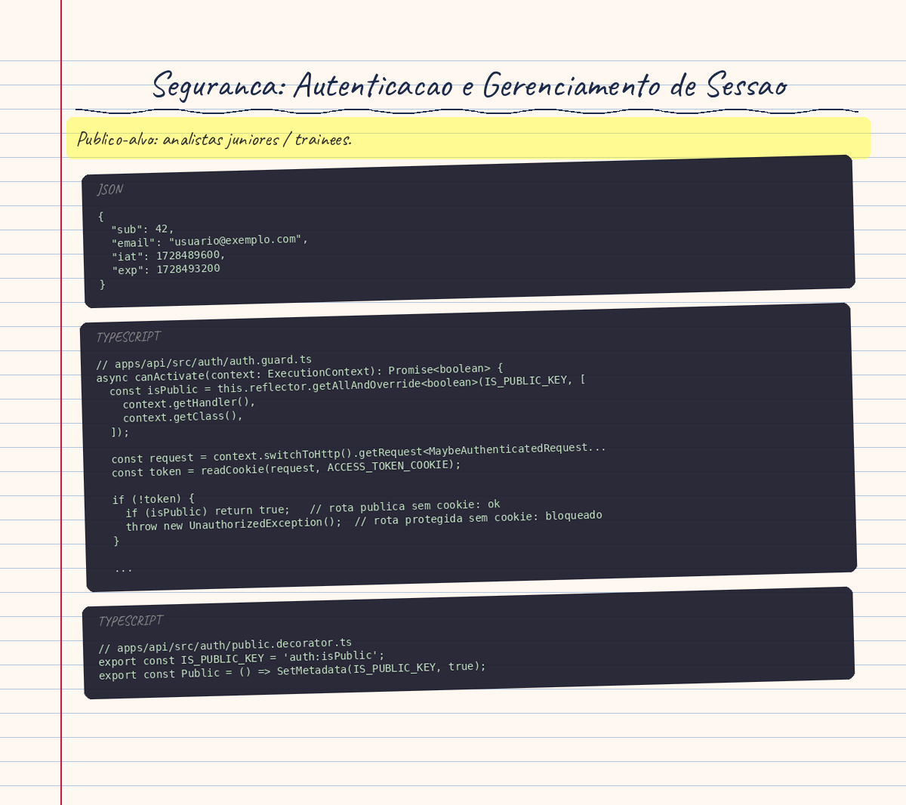

# Seguranca: Autenticacao e Gerenciamento de Sessao

> Publico-alvo: analistas juniores / trainees.

## Conceito Teorico

Imagine que voce chega a um evento e mostra seu ingresso na entrada. O seguranca carimba sua mao. A partir dai, voce nao precisa mais mostrar o ingresso — basta mostrar a mao carimbada a cada area restrita que quiser acessar. Quando a festa acaba, voce lava a mao. O carimbo sumiu. Mas e se alguem tivesse fotografado o carimbo antes? Poderia imitar sua mao. Esse e, em essencia, o trade-off central da autenticacao stateless.

### Sessoes via Cookie vs. Bearer Tokens

Ha duas formas principais de manter uma sessao apos o login:

**Bearer Token (cabecalho HTTP):** O token e devolvido no corpo da resposta do login. O cliente (geralmente o JavaScript do navegador) guarda esse token — tipicamente em `localStorage` ou `sessionStorage` — e o reenvia em cada requisicao dentro do cabecalho `Authorization: Bearer <token>`. O problema: qualquer script malicioso injetado na pagina (XSS) pode ler o `localStorage` e roubar o token.

**Cookie HttpOnly:** O servidor entrega o token dentro de um cookie marcado com o atributo `HttpOnly`. O navegador armazena e reenvia o cookie automaticamente a cada requisicao, mas **nenhum script JavaScript consegue ler o valor do cookie**. Um ataque XSS que injeta codigo na pagina nao consegue mais roubar a sessao, porque o proprio navegador bloqueia o acesso.

O Code Connect escolheu cookies HttpOnly exatamente por esse motivo: a superficie de ataque XSS fica eliminada para o roubo de sessao.

### JWT: O Que Fica Dentro do Token

JWT (JSON Web Token) e um formato de token composto por tres partes separadas por pontos: `header.payload.signature`.

- **Header:** descreve o algoritmo de assinatura (aqui, sempre `HS256`).
- **Payload:** os dados da sessao, em JSON puro. **Nao e criptografado** — qualquer um que tenha o token pode decodificar o payload em Base64 e ler o conteudo. Por isso, nunca inclua dados sensiveis (senha, numero de cartao) no payload.
- **Signature:** o HMAC-SHA256 do header + payload, calculado com uma chave secreta conhecida apenas pelo servidor. Sem a chave, e impossivel forjar um token valido.

O payload minimo do Code Connect contem apenas:

```json
{
  "sub": 42,
  "email": "usuario@exemplo.com",
  "iat": 1728489600,
  "exp": 1728493200
}
```

`sub` e o ID do usuario no banco. `email` e exibido na interface sem nova consulta ao banco. `iat` e `exp` sao campos padrao do JWT: data de emissao e data de expiracao.

---

## Aplicacao no Code Connect

### AuthGuard: Fail-Closed (Falhar Fechado)

"Fail-closed" significa que, diante de qualquer duvida, o sistema bloqueia o acesso — nao libera. E o oposto de "fail-open" (liberar na duvida), que e um erro classico de seguranca.

O `AuthGuard` e registrado **globalmente** no `AppModule`. Isso significa que **toda rota nova criada no projeto ja nasce protegida por padrao**. Um desenvolvedor que esquece de adicionar um decorador de autenticacao nao cria acidentalmente uma rota publica — ele deixa a rota protegida.

```typescript
// apps/api/src/auth/auth.guard.ts
async canActivate(context: ExecutionContext): Promise<boolean> {
  const isPublic = this.reflector.getAllAndOverride<boolean>(IS_PUBLIC_KEY, [
    context.getHandler(),
    context.getClass(),
  ]);

  const request = context.switchToHttp().getRequest<MaybeAuthenticatedRequest>();
  const token = readCookie(request, ACCESS_TOKEN_COOKIE);

  if (!token) {
    if (isPublic) return true;   // rota publica sem cookie: ok
    throw new UnauthorizedException();  // rota protegida sem cookie: bloqueado
  }

  try {
    request.user = await this.jwtService.verifyAsync<JwtPayload>(token, {
      secret: getJwtSecret(),
      algorithms: [JWT_ALGORITHM],
    });
  } catch {
    if (isPublic) return true;   // rota publica com token invalido: ok
    throw new UnauthorizedException();  // rota protegida com token invalido: bloqueado
  }
  return true;
}
```

O guard lanca `UnauthorizedException` (HTTP 401) em qualquer caminho de erro em uma rota protegida. Nunca retorna `false` silenciosamente — sempre rejeita explicitamente.

### @Public(): Opt-Out de Autenticacao

Quando uma rota precisa ser acessivel sem login (ex: pagina inicial, documentacao, cadastro), o desenvolvedor aplica o decorador `@Public()`.

```typescript
// apps/api/src/auth/public.decorator.ts
export const IS_PUBLIC_KEY = 'auth:isPublic';
export const Public = () => SetMetadata(IS_PUBLIC_KEY, true);
```

O `AuthGuard` usa `Reflector` para ler esse metadado na rota ou no controller. Se encontrar `isPublic = true`, muda de comportamento: em vez de rejeitar na ausencia ou invalidade do token, ele simplesmente retorna `true` (acesso liberado).

**Detalhe importante:** em uma rota `@Public()`, o guard ainda *tenta* verificar o cookie. Se o token for valido, ele popula `request.user` normalmente. Isso permite que o feed publico de posts saiba se *voce* ja curtiu cada post sem precisar de uma rota separada protegida. Se o token for invalido ou ausente, `request.user` simplesmente nao e definido — nenhum erro e lancado.

### Algoritmo Fixo: HS256

```typescript
// apps/api/src/auth/auth.constants.ts
export const JWT_ALGORITHM = 'HS256';
```

O projeto pina o algoritmo em `HS256` por uma razao de seguranca critica: historicamente, implementacoes de JWT aceitavam o algoritmo declarado *dentro do proprio token* (`alg` no header). Um atacante poderia forjar um token com `"alg": "none"` — sem assinatura — e a biblioteca o aceitaria como valido. Ao fixar `algorithms: [JWT_ALGORITHM]` na verificacao, o projeto rejeita qualquer token que nao tenha sido assinado exatamente com HS256, mesmo que o header do token diga outro algoritmo.

### "Lembrar-me": Coordenacao entre Cookie e JWT

Quando o usuario marca "Lembrar-me" no login, duas coisas precisam ser coordenadas:

1. **O token JWT** precisa ter um `exp` mais distante no futuro.
2. **O cookie** precisa ter um `Max-Age` equivalente — caso contrario, o cookie expira antes do token (o usuario e deslogado prematuramente) ou o cookie persiste depois do token (o usuario fica com um cookie inutil que so gera 401s).

```typescript
// apps/api/src/auth/auth.service.ts
const expiresIn = remember ? REMEMBER_ME_EXPIRES_IN_SECONDS : JWT_EXPIRES_IN_SECONDS;
return {
  accessToken: await this.jwtService.signAsync(payload, { expiresIn }),
  tokenType: 'Bearer',
  expiresIn,  // devolvido para o controller setar o mesmo valor no cookie
};
```

```typescript
// apps/api/src/auth/cookie.constants.ts
export function getSessionCookieOptions(remember: boolean, maxAgeSeconds: number): CookieOptions {
  return {
    ...baseCookieOptions(),
    httpOnly: true,
    ...(remember ? { maxAge: maxAgeSeconds * 1000 } : {}),
  };
}
```

Sem `Max-Age`, o cookie e um "session cookie": o navegador o descarta ao fechar. Com `Max-Age`, o navegador o persiste ate a data calculada. O valor em milissegundos (`maxAgeSeconds * 1000`) espelha exatamente o `expiresIn` do JWT em segundos.

Os valores padrao sao:
- Sem "lembrar-me": `JWT_EXPIRES_IN` = 1 hora (3600 segundos)
- Com "lembrar-me": `REMEMBER_ME_EXPIRES_IN` = 7 dias (604800 segundos)

Ambos podem ser sobrescritos via variaveis de ambiente do mesmo nome.

### Opcoes de Cookie: Cada Atributo e uma Camada de Defesa

```typescript
// apps/api/src/auth/cookie.constants.ts
function baseCookieOptions() {
  return {
    secure: isCookieSecure(),     // HTTPS only em producao
    sameSite: getCookieSameSite(), // 'strict' por padrao
    path: '/',                     // visivel em toda a API
    domain: getCookieDomain(),     // configuravel por env
  };
}
```

| Atributo | O que faz | Por que importa |
|---|---|---|
| `HttpOnly` | Bloqueia acesso via JavaScript | Mitiga roubo de sessao por XSS |
| `Secure` | So envia o cookie em HTTPS | Impede interceptacao em redes inseguras |
| `SameSite=Strict` | Nao envia o cookie em requisicoes cross-site | Principal defesa contra CSRF |
| `Path=/` | Envia o cookie para toda a API | Sem `Path`, o browser escopa ao caminho da resposta que o criou (ex: `/auth`) — rotas fora de `/auth` nunca receberiam o cookie |

**Por que `Secure` e desligado em desenvolvimento?** O Safari nao trata `http://localhost` como seguro, e o `supertest` (usado nos testes e2e) recusa cookies `Secure` em conexoes HTTP. Ativar `Secure` em dev quebraria todos os testes de autenticacao.

### Prefixo `__Host-`: Defesa contra Injecao de Cookie por Subdominio

Em producao, alguns cookies do fluxo OIDC (login social) ganham o prefixo `__Host-`:

```typescript
// apps/api/src/auth/cookie.constants.ts
export function getOidcFlowCookieName(): string {
  return useHostPrefix() ? '__Host-oidc_flow' : 'oidc_flow';
}
```

Um cookie com o prefixo `__Host-` tem tres restricoes impostas pelo proprio navegador:
1. O cookie precisa de `Secure` (HTTPS).
2. O cookie nao pode ter um atributo `Domain` — fica restrito ao host exato.
3. O `Path` deve ser `/`.

Sem esse prefixo, um subdominio malicioso (`evil.exemplo.com`) poderia injetar um cookie com `Domain=exemplo.com`, que o navegador repassaria para `api.exemplo.com`. O prefixo elimina esse vetor, porque o navegador rejeita qualquer cookie `__Host-` que tente definir um `Domain`.

### Logout Stateless: o Trade-off do JWT

O logout no Code Connect funciona limpando o cookie do browser:

```typescript
// O controller chama res.clearCookie(ACCESS_TOKEN_COOKIE, getClearCookieOptions())
```

**O problema:** o JWT continua valido ate seu `exp`. Se alguem copiou o valor do cookie antes do logout (por acesso fisico ao computador, por exemplo), o token copiado ainda funciona ate expirar.

Esse e o trade-off classico do JWT stateless:

| Aspecto | JWT Stateless | Sessao Stateful (banco/Redis) |
|---|---|---|
| Escalabilidade | Excelente (sem consulta ao banco) | Requer armazenamento compartilhado |
| Logout imediato | Nao — token fica valido ate `exp` | Sim — apaga a sessao no store |
| Complexidade operacional | Baixa | Necessita Redis ou tabela de sessoes |

O Code Connect aceita esse trade-off. Para a maioria dos casos de uso, um token que expira em 1 hora e janela de vulnerabilidade aceitavel. Se seguranca maxima fosse necessaria, seria preciso manter uma "blocklist" de tokens revogados — com custo operacional equivalente a uma sessao stateful.

### Prevencao BOLA/IDOR: Derivar o Ator do Token

BOLA (Broken Object Level Authorization) — tambem chamado IDOR — ocorre quando um endpoint usa um ID fornecido pelo cliente para identificar "de quem" e a operacao, sem verificar se o token pertence a esse usuario.

Exemplo inseguro (nunca faca isso):
```typescript
// ERRADO: confia no corpo da requisicao
async deletePost(@Body('userId') userId: number) {
  await this.postsService.deleteAllPostsByUser(userId);
}
```

Qualquer usuario poderia colocar `userId: 1` no corpo e deletar os posts do usuario 1.

O Code Connect usa `@CurrentUser()` para resolver isso:

```typescript
// apps/api/src/auth/current-user.decorator.ts
export const CurrentUser = createParamDecorator(
  (_data: unknown, context: ExecutionContext): JwtPayload =>
    context.switchToHttp().getRequest<AuthenticatedRequest>().user,
);
```

`request.user` foi populado pelo `AuthGuard` a partir do JWT verificado — nao do corpo da requisicao. O `sub` (ID do usuario) vem do token assinado pelo servidor, nao de um parametro que o cliente pode falsificar.

Uso correto no controller:
```typescript
async deleteMyPosts(@CurrentUser() user: JwtPayload) {
  await this.postsService.deleteAllPostsByUser(user.sub); // ID vem do token
}
```

### Segredo JWT: Producao vs. Desenvolvimento

```typescript
// apps/api/src/auth/auth.constants.ts
export function getJwtSecret(): string {
  const secret = process.env.JWT_SECRET;
  if (secret) return secret;
  if (process.env.NODE_ENV === 'production') {
    throw new Error('JWT_SECRET must be set in production');
  }
  return DEV_SECRET;
}
```

O projeto falha em startup em producao se `JWT_SECRET` nao estiver configurada. Em desenvolvimento, usa um segredo fixo (`'dev-only-secret-change-me'`) para nao exigir setup de `.env` para rodar localmente. Essa distinção e deliberada — o segredo fixo de dev e intencionalmente simples para deixar claro que nao e para producao.

---

## Erros Comuns e Armadilhas

**1. Criar uma rota protegida sem perceber que ela ja e protegida**
Como o `AuthGuard` e global, toda rota nova ja nasce exigindo login. Nao e necessario — nem correto — adicionar `@UseGuards(AuthGuard)` manualmente. Fazer isso duplica o guard, sem efeito pratico, mas gera confusao.

**2. Usar `@Public()` em rotas que deveriam ser protegidas**
O `@Public()` e para opt-out real: saude, documentacao, cadastro, login. Nao use para "facilitar o desenvolvimento" — isso e o erro "fail-open".

**3. Confiar no `request.user` em rotas `@Public()`**
Em uma rota `@Public()`, `request.user` pode ser `undefined` (usuario nao logado). O tipo correto e `MaybeAuthenticatedRequest`, nao `AuthenticatedRequest`. Acessar `request.user.sub` sem verificar resulta em `TypeError: Cannot read properties of undefined`.

**4. Divergencia entre `Max-Age` do cookie e `expiresIn` do JWT**
Se o cookie expirar antes do token, o usuario e deslogado prematuramente mesmo com um token valido no browser. Se o token expirar antes do cookie, toda requisicao retorna 401 com o cookie ainda presente — o usuario parece "logado" mas nao consegue fazer nada. Sempre use o `expiresIn` retornado por `AuthService.signIn()` para setar o `Max-Age`.

**5. Esquecer o `path: '/'` no cookie**
Sem `path`, o Express escopa o cookie ao caminho da rota que o criou. Um cookie criado em `POST /auth/login` ficaria restrito a `/auth/*`. Uma requisicao para `GET /posts` nunca receberia o cookie de sessao.

**6. Confundir "decodificar" com "verificar" o JWT**
O payload do JWT e apenas Base64 — qualquer um pode decodifica-lo com `atob()` no browser. "Verificar" o token significa checar a **assinatura** com a chave secreta. `jwtService.decode()` so decodifica; `jwtService.verifyAsync()` valida a assinatura. Use sempre `verifyAsync`.

**7. Usar `alg: none` ou deixar o algoritmo aberto**
Uma biblioteca que aceita o algoritmo declarado no proprio token pode ser enganada com `"alg": "none"`. O projeto fixa `algorithms: [JWT_ALGORITHM]` explicitamente na verificacao para eliminar esse vetor.

**8. Incluir dados sensiveis no payload do JWT**
O payload nao e criptografado — e apenas codificado em Base64. Qualquer pessoa com acesso ao token ve o conteudo. Nunca coloque senhas, numeros de cartao, segredos ou dados pessoais sensiveis no payload. O payload minimo (`sub` + `email`) e suficiente.

**9. Achar que `res.clearCookie()` invalida o JWT**
O logout limpa o cookie no browser, mas o JWT continua criptograficamente valido ate seu `exp`. Isso e o trade-off do stateless. Um atacante que capturou o token antes do logout pode usa-lo ate ele expirar.

**10. Remover o cookie com atributos diferentes dos usados na criacao**
`res.clearCookie()` precisa receber exatamente os mesmos atributos `path` e `domain` usados em `res.cookie()`. Se um atributo divergir, o browser interpreta como um cookie diferente e mantem o original intacto. Por isso existe `getClearCookieOptions()` — para garantir consistencia.

---

## Rastreabilidade

| Conceito | Arquivo | Linha/Trecho |
|----------|---------|--------------|
| AuthGuard (fail-closed, global) | `apps/api/src/auth/auth.guard.ts` | Linhas 1–60 |
| Verificacao do JWT (`verifyAsync`) | `apps/api/src/auth/auth.guard.ts` | Linhas 50–57 |
| Algoritmo fixo `HS256` | `apps/api/src/auth/auth.constants.ts` | Linha 14 |
| Segredo JWT com fallback de dev | `apps/api/src/auth/auth.constants.ts` | Linhas 1–10 |
| `JWT_EXPIRES_IN_SECONDS` e `REMEMBER_ME_EXPIRES_IN_SECONDS` | `apps/api/src/auth/auth.constants.ts` | Linhas 29–43 |
| SignIn com "lembrar-me" e rehash de senha | `apps/api/src/auth/auth.service.ts` | Linhas 15–57 |
| Payload minimo `JwtPayload` (`sub` + `email`) | `apps/api/src/auth/auth.types.ts` | Linhas 3–6 |
| `MaybeAuthenticatedRequest` vs `AuthenticatedRequest` | `apps/api/src/auth/auth.types.ts` | Linhas 19–22 |
| `@Public()` decorator | `apps/api/src/auth/public.decorator.ts` | Linhas 1–7 |
| `@CurrentUser()` decorator | `apps/api/src/auth/current-user.decorator.ts` | Linhas 1–9 |
| Nome do cookie (`access_token`) | `apps/api/src/auth/cookie.constants.ts` | Linha 3 |
| `HttpOnly`, `Secure`, `SameSite`, `Path` | `apps/api/src/auth/cookie.constants.ts` | Linhas 34–63 |
| Prefixo `__Host-` (OIDC) | `apps/api/src/auth/cookie.constants.ts` | Linhas 107–114 |
| `isCookieSecure()` (Secure desligado em dev) | `apps/api/src/auth/cookie.constants.ts` | Linhas 17–21 |
| Leitura robusta do cookie (com e sem cookie-parser) | `apps/api/src/auth/cookies.ts` | Linhas 9–25 |
| Testes de sessao invalida (sem cookie, token forjado, expirado, usuario deletado) | `apps/api/test/security.e2e-spec.ts` | Linhas 43–93 |
| Testes de CSRF (sem header, header errado, token de outra sessao) | `apps/api/test/security.e2e-spec.ts` | Linhas 95–152 |

---

_Ultima atualizacao: 2026-10-09 | Gerado a partir do codigo-fonte._

<!-- infographic-start -->

<!-- infographic-end -->
