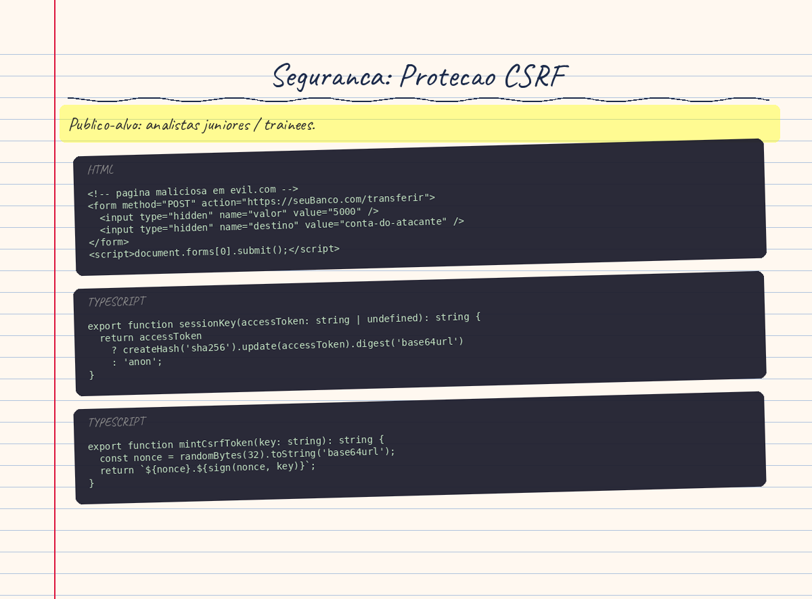

# Seguranca: Protecao CSRF

> **Publico-alvo:** analistas juniores / trainees.

## Conceito Teorico

### O que e um ataque CSRF?

Imagine que voce esta logado no seu banco on-line. Em outro aba, voce abre um link malicioso que contem este HTML:

```html
<!-- pagina maliciosa em evil.com -->
<form method="POST" action="https://seuBanco.com/transferir">
  <input type="hidden" name="valor" value="5000" />
  <input type="hidden" name="destino" value="conta-do-atacante" />
</form>
<script>document.forms[0].submit();</script>
```

Quando esse script roda, o _seu_ browser envia um POST para `seuBanco.com` com _seus_ cookies de sessao incluidos automaticamente — porque o browser sempre anexa cookies ao dominio correto, independente de qual site originou a requisicao. O banco recebe o pedido, ve que os cookies sao validos e executa a transferencia.

Esse e o ataque **CSRF (Cross-Site Request Forgery)**: um site malicioso _forja_ uma requisicao em nome de uma vitima autenticada sem que ela saiba.

A anatomy do ataque tem tres pre-requisitos:

1. A vitima esta autenticada no site alvo (tem cookies validos).
2. O site alvo confia em requisicoes baseadas apenas em cookies.
3. O atacante consegue prever a forma da requisicao (URL, parametros).

### Por que `SameSite=Strict` sozinho nao previne login CSRF

`SameSite=Strict` e uma otima defesa para sessoes ja estabelecidas: o browser so envia o cookie se a requisicao _originou_ do mesmo site. Um POST vindo de `evil.com` para `suaApp.com` nao carregaria o cookie.

Mas existe um cenario chamado **login CSRF** em que `SameSite=Strict` falha:

1. Atacante tem credenciais de uma conta _propria_ na sua aplicacao.
2. Atacante cria uma pagina que envia automaticamente um POST para `/auth/login` com as credenciais _dele_.
3. Vitima visita essa pagina. O browser envia o POST — sem cookie de sessao (pois a vitima ainda nao esta logada), portanto `SameSite=Strict` nao filtra nada.
4. O servidor processa o login com sucesso e emite `Set-Cookie: access_token=...` na resposta do POST cross-site.
5. **O browser armazena o cookie** mesmo sendo uma resposta cross-site.
6. Agora a vitima esta logada como _o atacante_. Qualquer dado que ela digitar (cartao de credito, endereco) vai para a conta do atacante.

O comentario no codigo do projeto documenta exatamente isso:

> _"SameSite=Strict alone doesn't stop login CSRF, since Set-Cookie on a cross-site POST response is still stored and sent on the victim's next same-site navigation."_
> — [apps/api/src/auth/csrf.guard.ts](../../apps/api/src/auth/csrf.guard.ts), linha 22-25

### O padrao double-submit cookie

A solucao e exigir que o cliente prove que _consegue ler_ o cookie — algo que um site externo nao pode fazer por causa da **Same-Origin Policy**.

O padrao **double-submit cookie** funciona assim:

1. O servidor gera um token secreto e o envia como um cookie **legivel por JS** (`httpOnly: false`).
2. O cliente (JavaScript) le o valor desse cookie e o inclui em um **header HTTP** (`X-CSRF-Token`).
3. O servidor valida que o valor no header e igual ao valor no cookie.

Um site malicioso em `evil.com` nao consegue ler cookies de `suaApp.com` (Same-Origin Policy bloqueia `document.cookie`). Portanto, nao consegue colocar o valor correto no header. A requisicao forjada e rejeitada.

### sessionKey: vinculando o token CSRF a sessao

O Code Connect vai alem do double-submit basico: o token CSRF e **criptograficamente vinculado a sessao atual**.

A funcao `sessionKey` em [apps/api/src/auth/csrf.ts](../../apps/api/src/auth/csrf.ts) deriva uma chave a partir do `access_token`:

```typescript
export function sessionKey(accessToken: string | undefined): string {
  return accessToken
    ? createHash('sha256').update(accessToken).digest('base64url')
    : 'anon';
}
```

Por que isso importa? Sem vinculacao de sessao, um token CSRF minted para um visitante anonimo poderia ser reutilizado depois do login. Com `sessionKey`:

- Token criado antes do login: `sessionKey(undefined)` → chave `'anon'`
- Token criado depois do login: `sessionKey('jwt-do-usuario')` → hash diferente
- O token pre-login falha na verificacao pos-login, forcando a obtencao de um novo token.

O SHA-256 e usado aqui como uma **funcao de derivacao** (nao autenticacao): converte o JWT — que pode ser longo e conter dados sensiveis — em uma chave curta e uniforme para assinar o CSRF token.

### HMAC: assinando o token criptograficamente

O token CSRF gerado pelo projeto tem o formato `nonce.mac`:

```typescript
export function mintCsrfToken(key: string): string {
  const nonce = randomBytes(32).toString('base64url');
  return `${nonce}.${sign(nonce, key)}`;
}
```

O `mac` e um **HMAC-SHA256** (Hash-based Message Authentication Code):

```typescript
function sign(nonce: string, key: string): string {
  return createHmac('sha256', getCsrfSecret())
    .update(`csrf:${nonce}:${key}`)
    .digest('base64url');
}
```

O HMAC funciona como uma "assinatura" que so pode ser criada por quem conhece o segredo (`CSRF_SECRET`). Isso da tres garantias:

1. **Autenticidade**: so o servidor pode gerar um MAC valido.
2. **Integridade**: qualquer alteracao no nonce ou na chave invalida o MAC.
3. **Vinculacao de sessao**: o `key` (derivado do access_token) faz parte da mensagem assinada, entao um MAC valido para a sessao A nao e valido para a sessao B.

O prefixo `'csrf:'` e uma tecnica de **domain separation**: garante que um HMAC gerado para uso CSRF nao possa ser reutilizado em outro contexto que use o mesmo segredo.

### `timingSafeEqual`: prevenindo timing attacks

A verificacao do token usa `timingSafeEqual` ao inves de `===`:

```typescript
return expected.length === actual.length && timingSafeEqual(expected, actual);
```

Por que isso importa? Uma comparacao de strings normal (`===`) para imediatamente quando encontra um caractere diferente. Isso cria uma **vulnerabilidade de timing**: medindo o tempo de resposta, um atacante pode descobrir quantos caracteres do MAC forjado estao corretos, permitindo adivinhar o valor byte por byte.

`timingSafeEqual` sempre percorre toda a string, independente de onde encontra a primeira diferenca — o tempo de execucao e constante. Um atacante que mede o tempo de resposta nao aprende nada sobre o valor correto.

---

## Aplicacao no Code Connect

### 1. Primitivas criptograficas (`csrf.ts`)

Arquivo: [apps/api/src/auth/csrf.ts](../../apps/api/src/auth/csrf.ts)

Este modulo exporta tres funcoes publicas e dois helpers internos:

| Funcao | Responsabilidade |
|--------|-----------------|
| `sessionKey(token)` | Deriva a chave de sessao (SHA-256 do JWT ou `'anon'`) |
| `mintCsrfToken(key)` | Gera `nonce.HMAC(nonce:key)` com 32 bytes de entropia |
| `verifyCsrfToken(token, key)` | Valida o par (nonce, MAC) em tempo constante |
| `getCsrfSecret()` _(interno)_ | Le `CSRF_SECRET` ou cai no `JWT_SECRET` como fallback |
| `sign(nonce, key)` _(interno)_ | Calcula o HMAC-SHA256 com domain separation |

O `getCsrfSecret()` e chamado a cada uso (nao capturado em `const` no nivel do modulo) porque os testes precisam fazer `vi.stubEnv` e trocar a variavel de ambiente. Uma `const` no nivel do modulo seria capturada na inicializacao e os stubs nao funcionariam.

**Fluxo de mintagem:**

```
randomBytes(32) → nonce
HMAC-SHA256(secret, "csrf:" + nonce + ":" + key) → mac
token = nonce + "." + mac
```

**Fluxo de verificacao:**

```
token.split('.') → [nonce, mac_recebido]
recalcula: mac_esperado = HMAC-SHA256(secret, "csrf:" + nonce + ":" + key)
timingSafeEqual(mac_esperado, mac_recebido) → true/false
```

### 2. `CsrfGuard`: protecao global e session-bound

Arquivo: [apps/api/src/auth/csrf.guard.ts](../../apps/api/src/auth/csrf.guard.ts)

O guard e registrado **globalmente** no `AuthModule` ao lado do `AuthGuard`, cobrindo todas as rotas da aplicacao por padrao.

**Logica de decisao do guard:**

```
requisicao entra
  ├── metodo e GET/HEAD/OPTIONS? → passa (metodos seguros, sem efeito colateral)
  ├── rota tem @NoCsrf()? → passa (escape hatch explicito)
  └── caso contrario: valida double-submit session-bound
        ├── le access_token cookie → deriva sessionKey
        ├── le csrf_token cookie (cookieToken)
        ├── le header X-CSRF-Token (headerToken)
        ├── cookieToken == headerToken? (double-submit)
        └── verifyCsrfToken(cookieToken, sessionKey)? → passa / ForbiddenException
```

O check `cookieToken === headerToken` (igualdade direta de strings) vem ANTES de `verifyCsrfToken`. Isso e intencional: se o header nao bater com o cookie, nao ha motivo para gastar CPU recalculando o HMAC.

O guard e intencional ao _nao_ olhar para a metadata `IS_PUBLIC_KEY` (usada pelo `AuthGuard`). Rotas `@Public()` como `/auth/login` e `/auth/signup` ainda precisam de CSRF — e exatamente isso que previne o login CSRF descrito na secao teorica.

### 3. `@NoCsrf()`: escape hatch para webhooks

Arquivo: [apps/api/src/auth/no-csrf.decorator.ts](../../apps/api/src/auth/no-csrf.decorator.ts)

```typescript
export const NoCsrf = () => SetMetadata(NO_CSRF_KEY, true);
```

E um simples decorator que grava metadados que o `CsrfGuard` le via `Reflector`. Hoje nao existe nenhuma rota com `@NoCsrf()` no projeto — o decorator foi criado antecipando a necessidade de webhooks ou integracoes machine-to-machine que genuinamente nao conseguem enviar um header customizado.

**Regra:** nao use `@NoCsrf()` para "simplificar" o desenvolvimento local. Use apenas para rotas que, por natureza tecnica, nao conseguem carregar o header.

### 4. Configuracao dos cookies (`cookie.constants.ts`)

Arquivo: [apps/api/src/auth/cookie.constants.ts](../../apps/api/src/auth/cookie.constants.ts)

Dois cookies cooperam para a protecao CSRF:

| Cookie | `httpOnly` | Proposito |
|--------|-----------|-----------|
| `access_token` | `true` | JWT de sessao — invisivel ao JS |
| `csrf_token` | `false` | Token CSRF — **legivel** pelo JS do frontend |

A diferenca de `httpOnly` e proposital e fundamental:

- `access_token` com `httpOnly: true` protege o JWT de ataques XSS — o JS malicioso nao consegue le-lo.
- `csrf_token` com `httpOnly: false` permite que o interceptor Axios do frontend leia e reenvie o valor no header — requisito do padrao double-submit.

Os dois cookies compartilham os mesmos atributos base via `baseCookieOptions()`:
- `SameSite`: configuravel (`strict` por padrao), bloqueia envio em contextos cross-site.
- `Secure`: automatico em producao, desligado em dev/test (Safari e supertest nao aceitam `Secure` em `http://localhost`).
- `path: '/'`: explicito para garantir que qualquer rota da API receba o cookie.

### 5. Frontend: interceptor Axios (`client.ts` + `csrf.ts`)

Arquivos: [apps/web/src/api/client.ts](../../apps/web/src/api/client.ts) e [apps/web/src/api/csrf.ts](../../apps/web/src/api/csrf.ts)

O frontend automatiza completamente o protocolo CSRF para que nenhuma tela precise se preocupar com isso.

**Interceptor de request** — attach automatico:

```typescript
api.interceptors.request.use(async (config) => {
  const method = config.method?.toLowerCase()
  if (method && UNSAFE_METHODS.has(method)) {
    const token = await ensureCsrfToken()
    if (token) {
      config.headers.set('X-CSRF-Token', token)
    }
  }
  return config
})
```

Para cada `POST`, `PUT`, `PATCH` ou `DELETE`:
1. Verifica se ja tem um `csrf_token` no `document.cookie`.
2. Se nao tem, dispara `GET /auth/csrf` para obter um (memoizado para evitar multiplas chamadas concorrentes).
3. Injeta o valor no header `X-CSRF-Token`.

**Interceptor de response** — retry automatico no 403:

```typescript
if (error.response?.status === 403 && config && !config._csrfRetried) {
  config._csrfRetried = true
  resetCsrfToken()
  await ensureCsrfToken()
  return api(config)
}
```

Se a API retorna 403, o frontend assume que o token expirou ou foi rotacionado (ex: login em outra aba). Ele:
1. Apaga o cookie local com `Max-Age=0`.
2. Busca um novo token via `GET /auth/csrf`.
3. Reexecuta a requisicao original **uma unica vez**.

O flag `_csrfRetried` no config evita loop infinito. E gravado diretamente no objeto de config (nao em um `WeakSet` externo) porque o Axios clona o config em cada tentativa — um `WeakSet` perderia a referencia original e o loop nunca terminaria.

**`ensureCsrfToken()` — memoizacao com Promise:**

```typescript
let bootstrap: Promise<string | undefined> | null = null

export function ensureCsrfToken(): Promise<string | undefined> {
  const existing = readCsrfCookie()
  if (existing) return Promise.resolve(existing)

  bootstrap ??= api.get('/auth/csrf')
    .then(() => readCsrfCookie())
    .finally(() => { bootstrap = null })
  return bootstrap
}
```

A variavel `bootstrap` e uma Promise memoizada. Se dois componentes montam ao mesmo tempo e ambos disparam uma mutacao, apenas um `GET /auth/csrf` e feito. Ambas as Promises resolvem com o mesmo token.

### 6. Bootstrap e rotacao do token

**Bootstrap (visitante anonimo):**

O endpoint `GET /auth/csrf` grava um `csrf_token` ligado a `sessionKey(undefined)` → chave `'anon'`. Qualquer POST de um visitante nao logado (ex: tela de cadastro) ja tem um token valido.

**Rotacao no login:**

Quando o usuario faz login com sucesso, o servidor emite um novo `access_token` cookie. Isso invalida automaticamente o token CSRF anterior (pois `sessionKey(novo-jwt)` difere de `'anon'`). O frontend detecta o 403 na proxima requisicao, refaz o bootstrap com o novo `sessionKey` e retenta.

Esse mecanismo garante que tokens CSRF anonimos nao sobrevivam a autenticacao — um token roubado antes do login nao serve para forjar requisicoes pos-login.

---

## Erros Comuns e Armadilhas

### 1. Esquecer que `@Public()` nao dispensa CSRF

Um erro comum e assumir que rotas sem autenticacao nao precisam de CSRF. Na verdade, o login CSRF e mais perigoso que um CSRF em rota autenticada: o atacante faz a vitima logar como _ele_, nao apenas forjar uma acao isolada.

```typescript
// ERRADO: auth developer assumed @Public() implies no CSRF needed
@Public()
@NoCsrf() // <-- nao faca isso no endpoint de login
@Post('login')
async login(...) {}
```

O `CsrfGuard` foi projetado para ignorar `@Public()` de proposito.

### 2. Usar `===` para comparar MACs

```typescript
// VULNERAVEL: revela informacao via timing
if (expectedMac === receivedMac) { ... }

// CORRETO: tempo constante
timingSafeEqual(Buffer.from(expectedMac), Buffer.from(receivedMac))
```

Comparacoes de strings JavaScript terminam no primeiro caractere diferente. Em producao, com muitas requisicoes, um atacante pode medir tempos medios e deduzir bits do MAC correto.

### 3. Capturar `getCsrfSecret()` em uma `const` de modulo

```typescript
// PROBLEMA: secret e capturado na inicializacao, testes nao conseguem stubbar
const CSRF_SECRET = process.env.CSRF_SECRET || getJwtSecret()

// CORRETO: chamado por uso, stubs de teste funcionam
function getCsrfSecret(): string {
  return process.env.CSRF_SECRET || getJwtSecret()
}
```

Testes que fazem `vi.stubEnv('CSRF_SECRET', 'valor')` esperam que a funcao leia a env _na hora da chamada_. Uma `const` de modulo seria avaliada antes do stub existir.

### 4. Esquecer o `_csrfRetried` no retry do interceptor

Se o interceptor de response retenta uma requisicao 403 sem marcar "ja retentatei", e o novo token tambem falhar (ex: bug no servidor), o retry entra em loop infinito ate o browser travar.

```typescript
// LOOP INFINITO: sem flag de controle
if (error.response?.status === 403) {
  resetCsrfToken()
  await ensureCsrfToken()
  return api(config) // dispara de novo → 403 → dispara de novo → ...
}
```

### 5. Rastrear o retry com `WeakSet` ou closure

```typescript
// QUEBRADO: Axios clona o config em cada retry
const retried = new WeakSet<InternalAxiosRequestConfig>()
if (!retried.has(config)) {
  retried.add(config) // adiciona o objeto ORIGINAL
  return api(config)  // Axios cria novo config → WeakSet nao reconhece → loop
}

// CORRETO: propriedade no proprio config sobrevive a clonagem
type RetriableConfig = InternalAxiosRequestConfig & { _csrfRetried?: boolean }
config._csrfRetried = true
```

### 6. Definir `httpOnly: true` no cookie CSRF

O padrao double-submit _precisa_ que o JS do frontend leia o cookie. Com `httpOnly: true`, `document.cookie` nao retorna o `csrf_token` e o interceptor nunca consegue o valor para colocar no header.

### 7. Omitir `path: '/'` nos cookies

Sem `path` explicito, o browser e o Express escopam o cookie ao caminho da resposta que o definiu. Se o login e em `/auth/login`, o cookie ficaria invisivel para rotas fora de `/auth`. O projeto define `path: '/'` explicitamente para garantir cobertura global.

### 8. Nao usar `CSRF_SECRET` separado do `JWT_SECRET`

O fallback para `JWT_SECRET` existe por conveniencia de configuracao, mas e desaconselhado em producao. Se o `JWT_SECRET` vazar, um atacante pode forjar CSRF tokens alem de JWTs. Separar os segredos limita o impacto de cada vazamento.

---

## Rastreabilidade

| Conceito | Arquivo | Linha/Trecho |
|----------|---------|--------------|
| `sessionKey` — SHA-256 do access_token | [apps/api/src/auth/csrf.ts](../../apps/api/src/auth/csrf.ts) | Linhas 15-19 |
| `mintCsrfToken` — nonce + HMAC | [apps/api/src/auth/csrf.ts](../../apps/api/src/auth/csrf.ts) | Linhas 28-31 |
| `verifyCsrfToken` — timingSafeEqual | [apps/api/src/auth/csrf.ts](../../apps/api/src/auth/csrf.ts) | Linhas 33-39 |
| `sign` — HMAC-SHA256 com domain separation | [apps/api/src/auth/csrf.ts](../../apps/api/src/auth/csrf.ts) | Linhas 22-26 |
| `getCsrfSecret` — fallback para JWT_SECRET | [apps/api/src/auth/csrf.ts](../../apps/api/src/auth/csrf.ts) | Linhas 7-9 |
| `CsrfGuard` — guard global, metodos unsafe | [apps/api/src/auth/csrf.guard.ts](../../apps/api/src/auth/csrf.guard.ts) | Linhas 27-54 |
| `SAFE_METHODS` — GET/HEAD/OPTIONS isentos | [apps/api/src/auth/csrf.guard.ts](../../apps/api/src/auth/csrf.guard.ts) | Linha 14 |
| Por que `@Public()` nao isenta CSRF | [apps/api/src/auth/csrf.guard.ts](../../apps/api/src/auth/csrf.guard.ts) | Comentario linhas 22-25 |
| `@NoCsrf()` — escape hatch M2M/webhook | [apps/api/src/auth/no-csrf.decorator.ts](../../apps/api/src/auth/no-csrf.decorator.ts) | Linhas 1-7 |
| Nomes dos cookies e header | [apps/api/src/auth/cookie.constants.ts](../../apps/api/src/auth/cookie.constants.ts) | Linhas 3-5 |
| `httpOnly: false` no CSRF cookie | [apps/api/src/auth/cookie.constants.ts](../../apps/api/src/auth/cookie.constants.ts) | Linha 65 |
| `httpOnly: true` no access_token cookie | [apps/api/src/auth/cookie.constants.ts](../../apps/api/src/auth/cookie.constants.ts) | Linha 59 |
| `Secure` desligado em dev/test (Safari) | [apps/api/src/auth/cookie.constants.ts](../../apps/api/src/auth/cookie.constants.ts) | Linhas 10-16 |
| `readCsrfCookie` — le `document.cookie` | [apps/web/src/api/csrf.ts](../../apps/web/src/api/csrf.ts) | Linhas 8-13 |
| `resetCsrfToken` — expira cookie localmente | [apps/web/src/api/csrf.ts](../../apps/web/src/api/csrf.ts) | Linhas 18-20 |
| `ensureCsrfToken` — bootstrap memoizado | [apps/web/src/api/csrf.ts](../../apps/web/src/api/csrf.ts) | Linhas 27-38 |
| Interceptor de request — attach do header | [apps/web/src/api/client.ts](../../apps/web/src/api/client.ts) | Linhas 34-43 |
| Interceptor de response — retry no 403 | [apps/web/src/api/client.ts](../../apps/web/src/api/client.ts) | Linhas 49-63 |
| `_csrfRetried` — flag anti-loop no retry | [apps/web/src/api/client.ts](../../apps/web/src/api/client.ts) | Linhas 19-20 |
| Testes unitarios das primitivas CSRF | [apps/api/src/auth/csrf.spec.ts](../../apps/api/src/auth/csrf.spec.ts) | Linhas 1-69 |
| Testes do CsrfGuard (incluindo login CSRF) | [apps/api/src/auth/csrf.guard.spec.ts](../../apps/api/src/auth/csrf.guard.spec.ts) | Linhas 1-110 |

---

_Ultima atualizacao: 2026-10-09 | Gerado a partir do codigo-fonte._

<!-- infographic-start -->

<!-- infographic-end -->
